# First-launch inspiration: "try first, sign up after"

How 20 real apps run their first minutes, before and at the sign-up ask, and what Wael Academy should borrow for its own first launch: splash → Wael's welcome → level (+ section) → favourite subject → a 3-screen mini-game from the Tunisian programme → reward → create an account to keep the progress or play again.

> **Sources and method.** The screens are captured from public pages: the free "showcase" previews on [ScreensDesign](https://screensdesign.com/showcase/) (recordings of real first launches, three to six screens each), App Store listings, the Appcues GoodUX teardown of Duolingo, and the apps' own websites. Flow timings like "at 1:04" refer to the ScreensDesign recording of that app. Flows change often through A/B tests, so treat the details as one snapshot (captured 15 Nov 2026), not the app's only version. Everything is described in my own words; UI microcopy is quoted only where the exact wording is the point.

## The short version

- **The best apps let the student win something before they ask for anything.** Duolingo moved its sign-up screen a few steps later and saw about **+20% daily active users**; later tuning of when and how to ask added another **+8.2%** ([First Round Review](https://review.firstround.com/the-tenets-of-a-b-testing-from-duolingos-master-growth-hacker)).
- **Two kinds of wall.** A _soft wall_ is a skippable "save your progress" screen with a quiet **Later**. A _hard wall_ comes after several wins and is required to go on. Duolingo runs three soft walls and one hard wall. That fits Wael's brief well: a soft ask after the reward, a hard ask on "play again".
- **The questions should feel like the game.** Kahoot! turns its setup into a mini-Kahoot. Brilliant asks your math level by showing real problems. Speak asks its questions out loud as a chat. None of them look like a form.
- **Tunisia's main competitor asks for an account first.** TakiAcademy's register page asks for an email or phone number and a password before anything else. A game-first Wael would stand out right away.

<svg class="gate-svg" viewBox="0 0 880 470" width="100%" role="img" aria-label="Timeline comparing where eight apps place the sign-up gate" xmlns="http://www.w3.org/2000/svg">

<text x="12" y="24" class="ink" style="font-size:15px">Where the account is asked for: the teal part of each track is what you can use before the wall</text>
<line x1="290" y1="40" x2="290" y2="410" class="sep"/>
<line x1="450" y1="40" x2="450" y2="410" class="sep"/>
<line x1="610" y1="40" x2="610" y2="410" class="sep"/>
<line x1="720" y1="40" x2="720" y2="410" class="sep"/>
<text x="230" y="56" text-anchor="middle" class="mut">Open / splash</text>
<text x="370" y="56" text-anchor="middle" class="mut">Questions</text>
<text x="530" y="56" text-anchor="middle" class="mut">Mini-lesson / quiz</text>
<text x="665" y="56" text-anchor="middle" class="mut">Result</text>
<text x="795" y="56" text-anchor="middle" class="mut">Core app</text>
<rect x="4" y="368" width="872" height="40" rx="10" class="wael"/>
<text x="12" y="85" class="ink">Duolingo</text>
<line x1="170" y1="80" x2="860" y2="80" class="trk"/><line x1="170" y1="80" x2="830" y2="80" class="free"/>
<circle cx="720" cy="80" r="8" class="soft"/><circle cx="770" cy="80" r="8" class="soft"/><rect x="822" y="72" width="16" height="16" rx="3" class="hard"/>
<text x="12" y="129" class="ink">Brilliant</text>
<line x1="170" y1="124" x2="860" y2="124" class="trk"/><line x1="170" y1="124" x2="450" y2="124" class="free"/>
<rect x="442" y="116" width="16" height="16" rx="3" class="hard"/><path d="M480 115 l9 9 -9 9 -9 -9z" class="pay"/>
<text x="12" y="173" class="ink">Kahoot!</text>
<line x1="170" y1="168" x2="860" y2="168" class="trk"/><line x1="170" y1="168" x2="450" y2="168" class="free"/>
<rect x="442" y="160" width="16" height="16" rx="3" class="hard"/>
<text x="12" y="217" class="ink">Babbel</text>
<line x1="170" y1="212" x2="860" y2="212" class="trk"/><line x1="170" y1="212" x2="450" y2="212" class="free"/>
<rect x="442" y="204" width="16" height="16" rx="3" class="hard"/><path d="M480 203 l9 9 -9 9 -9 -9z" class="pay"/>
<text x="12" y="261" class="ink">Busuu</text>
<line x1="170" y1="256" x2="860" y2="256" class="trk"/><line x1="170" y1="256" x2="290" y2="256" class="free"/>
<rect x="282" y="248" width="16" height="16" rx="3" class="hard"/><path d="M440 247 l9 9 -9 9 -9 -9z" class="pay"/>
<text x="12" y="305" class="ink">Headspace</text>
<line x1="170" y1="300" x2="860" y2="300" class="trk"/><line x1="170" y1="300" x2="290" y2="300" class="free"/>
<rect x="282" y="292" width="16" height="16" rx="3" class="hard"/><path d="M440 291 l9 9 -9 9 -9 -9z" class="pay"/>
<text x="12" y="349" class="ink">TakiAcademy (web)</text>
<line x1="170" y1="344" x2="860" y2="344" class="trk"/><line x1="170" y1="344" x2="200" y2="344" class="free"/>
<rect x="192" y="336" width="16" height="16" rx="3" class="hard"/>
<text x="12" y="393" class="ink" style="font-weight:800">Wael (proposed)</text>
<line x1="170" y1="388" x2="860" y2="388" class="trk"/><line x1="170" y1="388" x2="790" y2="388" class="free"/>
<circle cx="720" cy="388" r="8" class="soft"/><rect x="782" y="380" width="16" height="16" rx="3" class="hard"/>
<text x="806" y="379" class="mut" style="font-size:11px">play again</text>
<circle cx="180" cy="444" r="8" class="soft"/><text x="196" y="448" class="mut">soft wall: skippable "save your progress", with Later</text>
<rect x="502" y="436" width="16" height="16" rx="3" class="hard"/><text x="526" y="448" class="mut">hard wall: account required</text>
<path d="M730 435 l9 9 -9 9 -9 -9z" class="pay"/><text x="746" y="448" class="mut">paywall / trial</text>
</svg>

_Diagram drawn for this document from the flows below. Positions are approximate, by stage, not by seconds._

## Learning apps

### 1. Duolingo: the reference for "play first"

**Flow.** Duo the owl greets you, then asks one question per screen: which language, how you heard about the app, why you are learning, a daily goal, and whether you are new or already know some. Beginners go straight into a first lesson. Others take a placement test that starts easy and gets harder as you answer ([Appcues GoodUX](https://goodux.appcues.com/blog/duolingo-user-onboarding)). In between, Duo reflects your answers back as a promise ("That's 25 words in your first week!") and offers a home-screen widget. After the lesson come a streak ignition screen ("Swipe up to ignite your streak!") and a Daily Quest progress bar. Only then does the profile ask appear. The ScreensDesign recording puts the new user into a lesson at about 2:44, before account creation; it counts about 45 onboarding steps in total ([ScreensDesign](https://screensdesign.com/showcase/duolingo-language-lessons)).

**Why it feels interactive.** Every screen has Duo in a speech bubble, so the questions read like a conversation, not a form. There is a progress bar at the top, chunky "lipped" buttons, a chime and a colour flash on every answer, and a streak flame you physically swipe up to light.

**The sign-up ask.** After the first lesson, a progress bar fills, then Duo holds up a phone: **"Time to create a profile!"** with the line "Create a profile to save your progress and continue learning for free," a big **CREATE PROFILE** button and a small **LATER** link. Duolingo found that a quiet "Later" worked better than an earlier red "Discard my progress" button. It now uses three skippable soft walls and one hard wall after several lessons ([First Round Review](https://review.firstround.com/the-tenets-of-a-b-testing-from-duolingos-master-growth-hacker)). **What you keep:** your course, XP, streak and level. Leaderboards stay locked until you have a profile ([Appcues GoodUX](https://goodux.appcues.com/blog/duolingo-user-onboarding)).

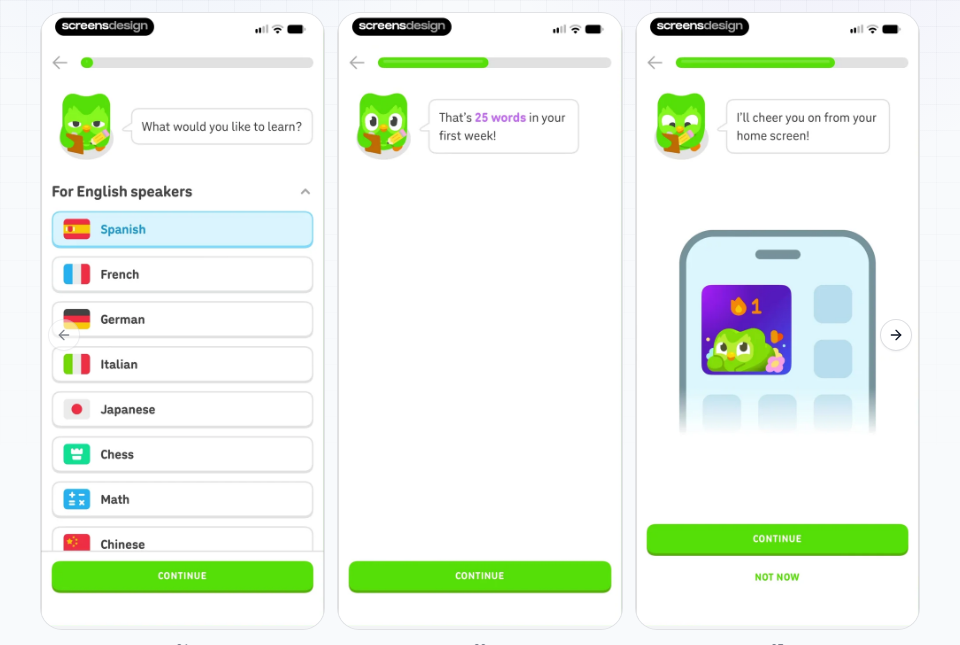
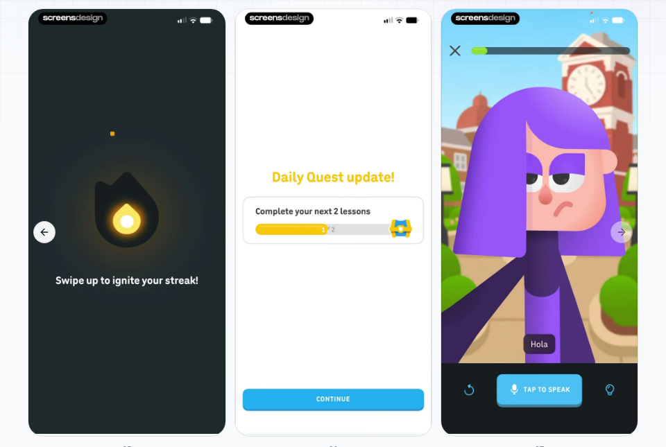
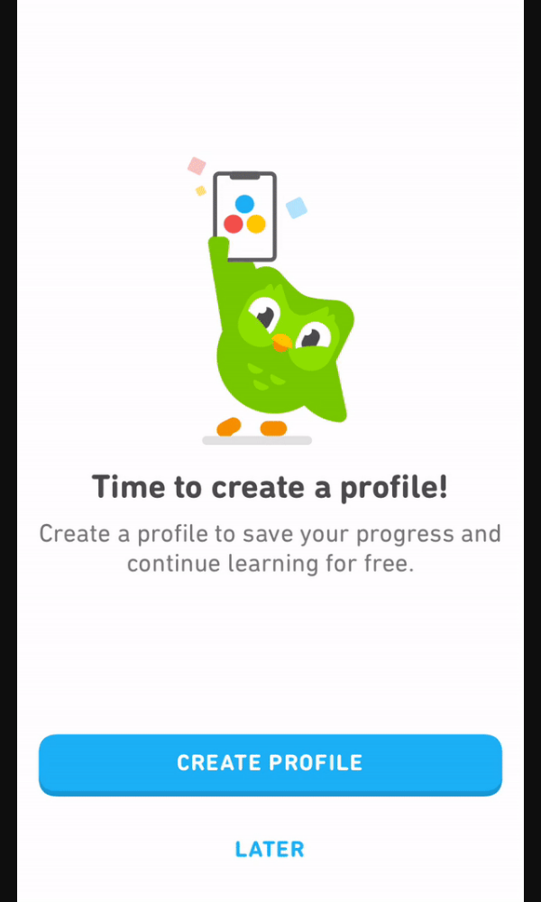
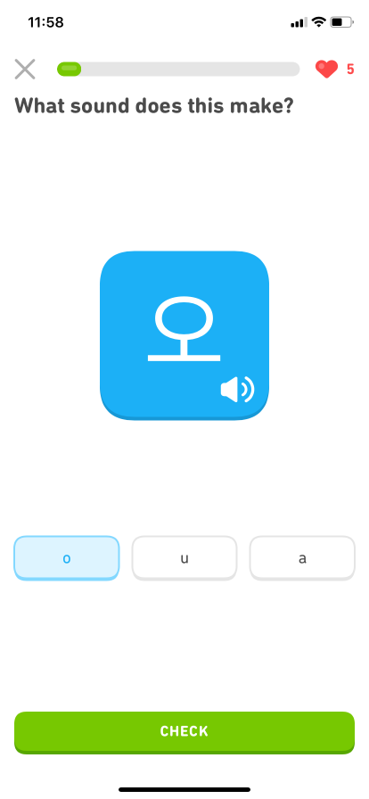

**Steal this**
- A **soft wall with "Later"** right after the reward, then a **hard wall** at "play again". That is exactly the brief.
- **Reflect each answer back as a promise** ("Bac Sciences? 3 minutes a day and you'll have reviewed a full chapter by Friday"), voiced by Wael in a speech bubble.
- **Ignite the streak on day 1** (a swipe or hold gesture), so there is already something to lose by skipping the account.

**Avoid.** The full 45-step flow is far too long for Wael. Keep the questions to two or three.

### 2. Brilliant: the level check uses real problems

**Flow.** "Which describes you best?" (student, professional, parent, lifelong learner, teacher…) with small character illustrations. Then "What is your math comfort level?" Each option is a **real problem**, not a label: arithmetic (5 × ½), pre-algebra (3x + 5 = 4), algebra (the quadratic formula), calculus (an integral). Next comes "Create a free account to discover your personalized learning path" (Apple, Google, Facebook or email), then a 7-day trial paywall, then "Recommendations" (learning paths with a "Most popular" tag). The first lesson is a visual weight-scale puzzle, ending on "Lesson complete!" with an XP counter ([ScreensDesign](https://screensdesign.com/showcase/brilliant-learn-by-doing)).

**Why it feels interactive.** You place yourself by recognising problems, which feels earned rather than declared. Loading screens use tangram animations instead of spinners. Wrong answers open interactive explanations.

**The sign-up ask.** It comes after the questions and before any lesson, framed as the reward: _your personalised path_. **What you keep:** the path built from your answers. ScreensDesign notes the downside: a sign-up wall and then a paywall, both before you have actually tried a lesson.

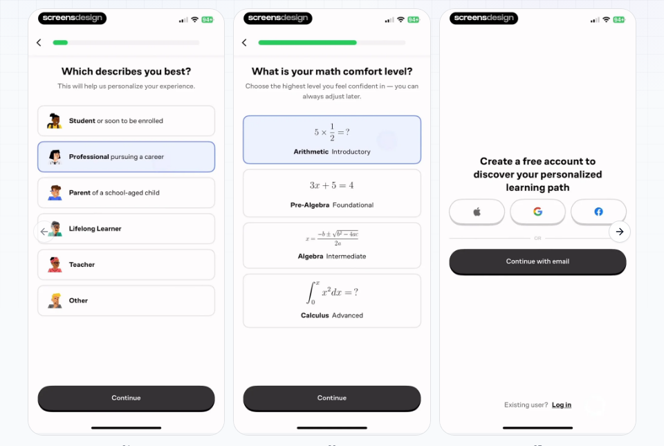
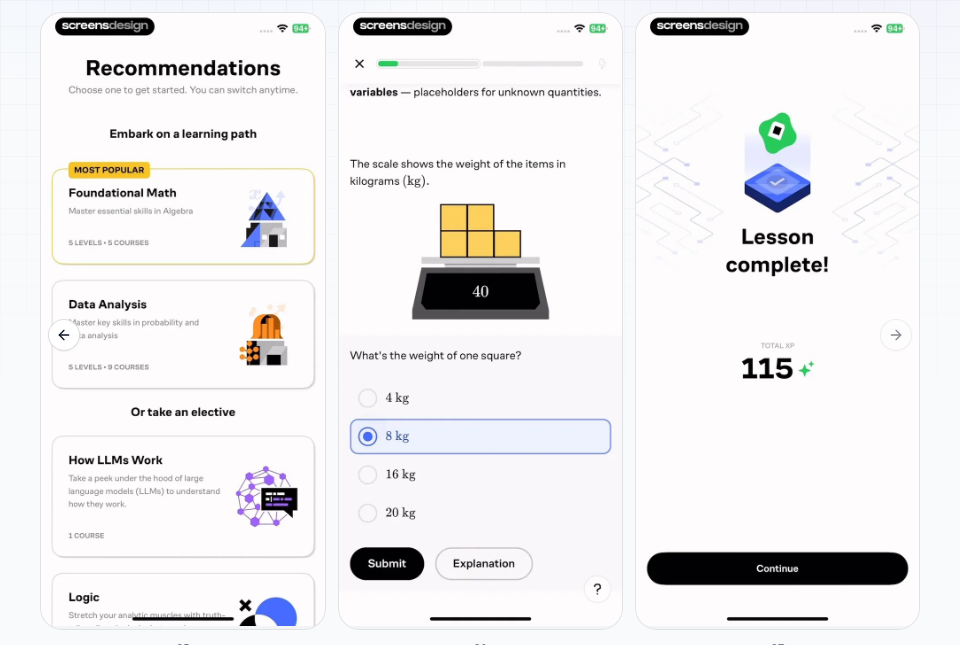

**Steal this**
- **Level cards that show a sample from that year's programme**: "1ère: solve 2x + 3 = 7", "Bac Maths: the limit of (eˣ − 1)/x". The student recognises their year instead of only reading a label.
- **Frame the account as "unlock your personal path"**, not "register".
- **A "Lesson complete!" screen built around one big number** (XP or stars).

**Avoid.** Putting the account and a paywall before the first puzzle. Wael's game should come first.

### 3. Mimo: a mascot, a slider and a first lesson you can feel

**Flow.** A robot-mascot carousel ("Learn to code"), then "Why are you learning to code?" (four illustrated options plus "None of these"), then "What do you want to learn?" (big career-path cards tagged "Most popular" and "Trending"), then an experience **slider** instead of radio buttons. A Pro paywall with a 14-day trial appears at about 1:21. The first lesson comes at about 2:38: tap code snippets and watch a live browser preview, with the robot cheering "Fantastic!" in a bottom sheet. Then a winding path with coins and a streak counter ([ScreensDesign](https://screensdesign.com/showcase/mimo-learn-codingprogramming)).

**Why it feels interactive.** Each tap produces a visible result (a real button appears in the preview). There is also a small "You'll fit right in" moment during the questions.

**The sign-up ask.** An "I already have an account" link on the first screen. The paywall comes before the lesson.

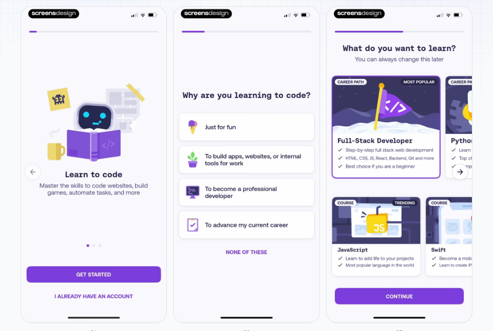
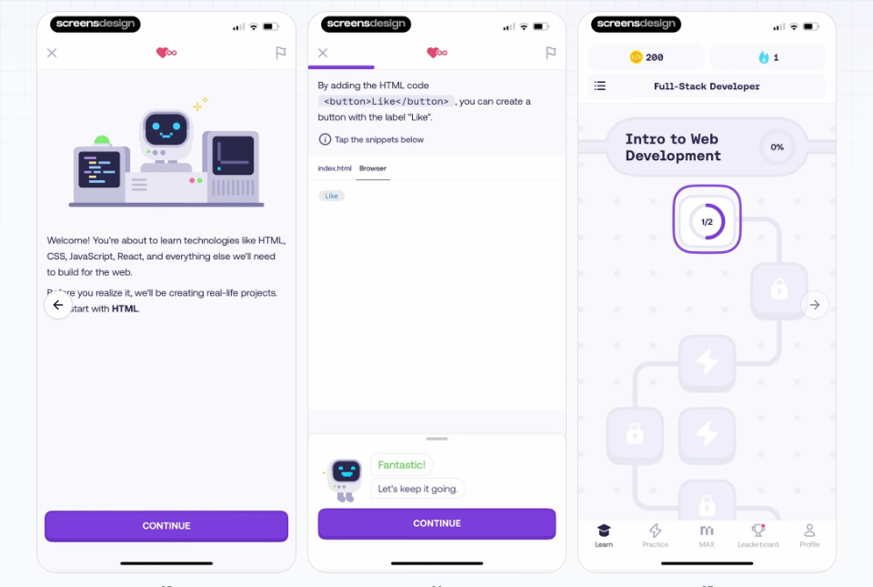

**Steal this**
- **The feedback bottom sheet**: the mascot plus a short line ("Fantastic! Let's keep it going") slides up after each answer. That is Wael's mini-game feedback pattern.
- **Use a slider or dial for "how confident are you in this subject?"** instead of a list.

### 4. Kahoot!: the onboarding is itself a Kahoot

**Flow.** "Choose your account type" is shown as the four classic Kahoot! answer tiles (red Teacher, blue Professional, yellow Student, green Personal). Tapping one gives a big green check and **"Great!"**, exactly like a correct answer in a game. Then "Create username" with a magic-wand button that generates one (e.g. "gentle_lark88"), then home with a coach mark pointing to the Join button ([ScreensDesign](https://screensdesign.com/showcase/kahoot-play-create-quizzes)).

**Why it feels interactive.** It uses the game's own grammar: timed answers, colour tiles and reinforcement screens. Setup teaches the core mechanic.

**The sign-up ask.** Right after the quiz-style questions. **What you keep:** your username, avatar and kahoots.

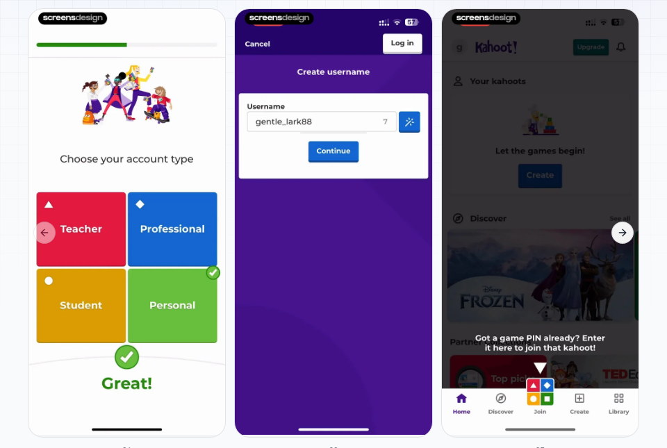

**Steal this**
- **Ask level, section and subject with the mini-game's own tiles and sounds.** The student is already playing before the first question.
- **A generated fun username** ("⁧بطل_الماط_42⁩") so the account step has a smile in it and one less field.

### 5. Speak: the questions are a conversation

**Flow.** "Adults can become fluent — even faster than kids." Then an AI tutor says it will ask three questions and asks you to answer out loud (a big microphone button, with "I can't speak now" as an escape). Next, "Here's what we learned about you": swipeable colour cards that restate your goal ("You want to use Spanish when you travel abroad"). A soft paywall with a progress graph follows at about 1:57. Lessons mix short teacher videos with speaking drills and end on **+9 XP**, a "1 day streak" pill and stat cards (sentences spoken, minutes studied) ([ScreensDesign](https://screensdesign.com/showcase/speak-learn-spanish-french)).

**Why it feels interactive.** Your voice is the input from the very first screen, and the summary cards prove the answers were heard.

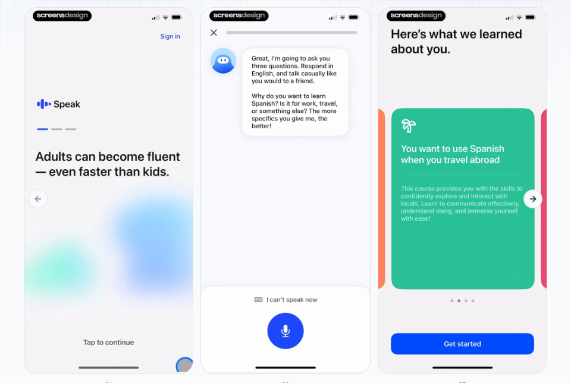
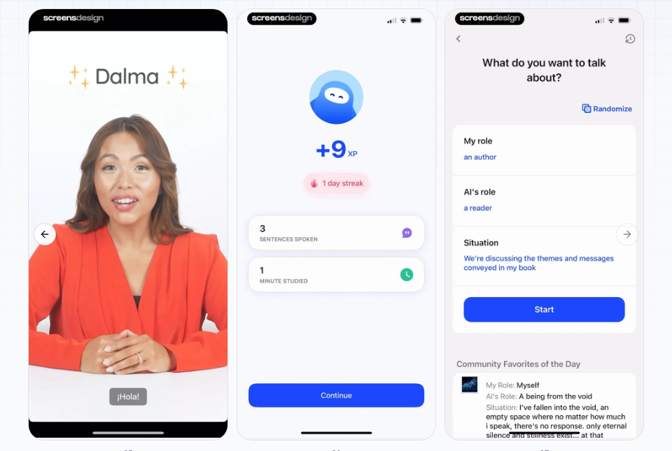

**Steal this**
- **"Here's what Wael learned about you"**: one card that restates level, section and subject before the game ("3ème Sciences, you love Physique, so let's go").
- **Honest result stats**: "3 questions, 2 correct, 1 min 40 s", next to the XP.

### 6. Babbel: a careful questionnaire, then a hard wall

**Flow.** Pick a language, then "Why do you want to learn Spanish?" (multi-select checkboxes, from family to "School or an exam"), "Which skills would you like to focus on?" (maximum 3, the rest grey out), level, and so on. Then a **mandatory sign-up** (Google, Facebook or Apple) at about 1:03, a soft paywall at 1:37, and only then the first lesson ([ScreensDesign](https://screensdesign.com/showcase/babbel-language-learning)).

**Why it feels interactive.** Mostly it doesn't: it is a well-designed form. The warm serif type and the "maximum 3" rule that greys out the rest are nice touches.

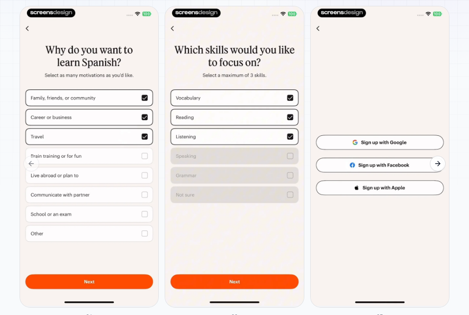

**Steal this**
- **"Pick up to 3" with the others greying out** would work for "which subjects do you need most?" later on, after sign-up.

**Avoid.** A hard wall before any taste of the product. ScreensDesign flags it as a likely drop-off point.

### 7. Busuu: sign up at step two (what not to do)

**Flow.** A friendly carousel ("Hola, soy Jane" / "Perfect!" speech bubbles), then **Start learning** opens a web sign-up form (email, name, password), then "Why are you learning Spanish?", a soft paywall at about 1:04, then lessons ([ScreensDesign](https://screensdesign.com/showcase/busuu-language-learning)).

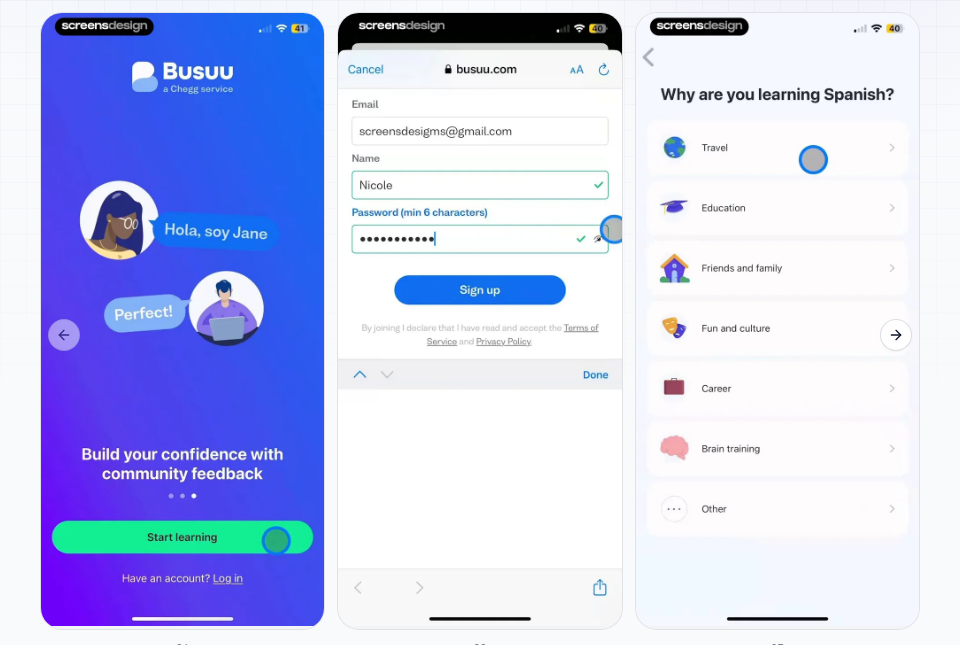

**Steal this.** The **two-speech-bubble illustration** on the splash (a learner and a native speaker) is a nice idea for Wael talking to a student.

**Avoid.** A full email-and-password form as the second screen. ScreensDesign's own note suggests letting people try a sample lesson first.

### 8. Elevate: "take this 1–2 minute test"

**Flow.** A 4-slide carousel ("Challenge your mind"), then yes/no goal cards ("Improve your vocabulary?"), then **"Now, take this 1-2 minute test to personalize your skill level"**: real mini-games that act as the assessment. Then a plan, a paywall with a testimonial and "Best deal – 67% off" at about 3:15, and a "Recommended" path where the upcoming games are hidden behind **"?" cards**. Games open with set pieces like a rocket launch ([ScreensDesign](https://screensdesign.com/showcase/elevate-brain-training-games)).

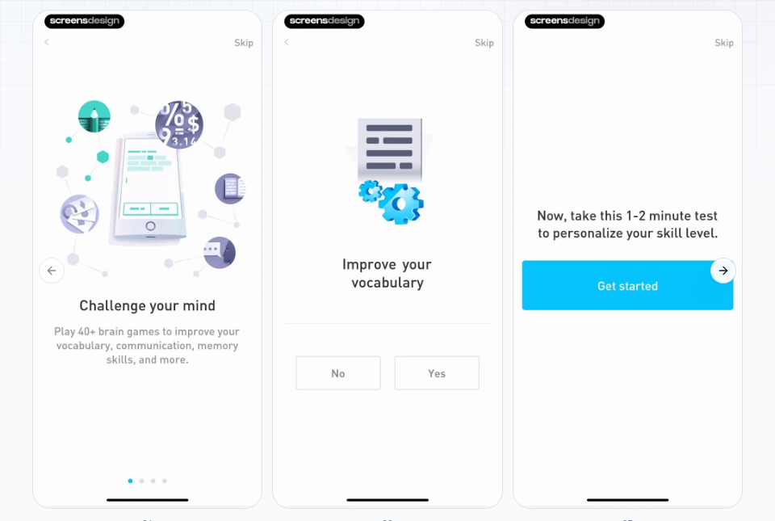
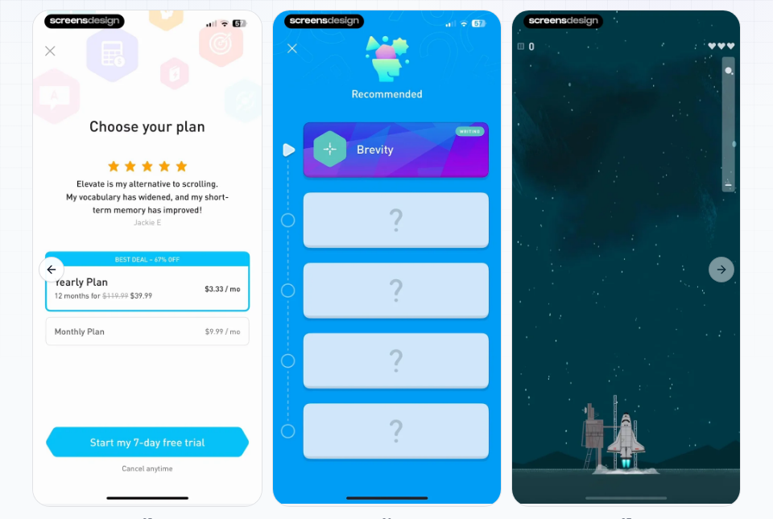

**Steal this**
- **Name the duration up front**: "3 questions, about 2 minutes". Teenagers commit more easily when they know the cost.
- **Mystery "?" cards** for the next chapters on the result screen. Curiosity is a reason to sign up.

### 9. Khan Academy: free, but account first

**Flow.** The first screen is the account screen ("A world class education for anyone, anywhere. 100% free." with Google, Facebook, Apple or email). Then "What courses can we help you learn?" (a long checkbox list), then a course page with mastery points (0/10,500) and "Up next for you" ([ScreensDesign](https://screensdesign.com/showcase/khan-academy)).

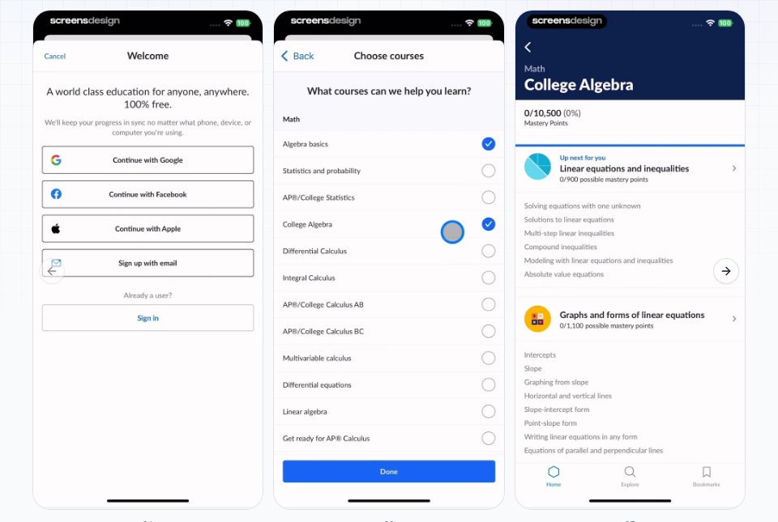

**Steal this.** **"Up next for you"** plus **mastery points out of a total** give a clear sense of a whole programme. Wael could show "1 of 24 chapters of Physique 3ème" on the result screen.

**Avoid.** Account as screen 1, and a long checkbox list for course choice.

### 10. Photomath: value in the first ten seconds

**Flow.** Three red slides ("Scan math problems for instant results", "Visualize each step with Animated Tutorials", "Compare solutions…"), camera and notification permissions, then straight to the camera. Solving is free. The paywall appears only when you tap **"Why?"** for a deeper explanation ([ScreensDesign](https://screensdesign.com/showcase/photomath)).

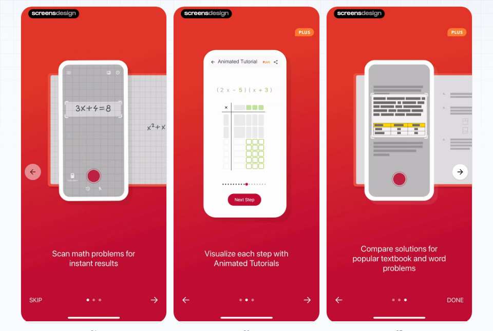

**Steal this.** **Gate the "why", not the "what".** In the mini-game the correct answer is always revealed, and the full worked explanation ("⁧شوف الحل خطوة بخطوة⁩") can be the reason to create an account.

### 11. Quizlet: sign-in, then paywall

**Flow.** Splash, Google sign-in, then **straight to "Choose your plan"** with a clear trial timeline (today, reminder, trial ends) at about 0:31, then the app ([ScreensDesign](https://screensdesign.com/showcase/quizlet-study-with-flashcards)).

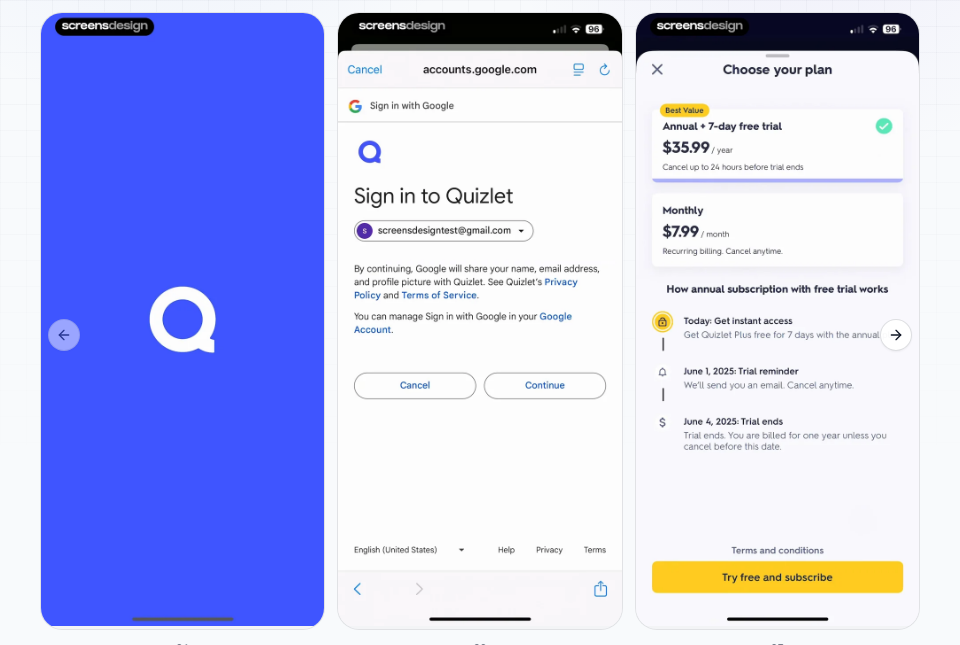

**Steal this.** If Wael ever shows paid offers at onboarding, a **trial timeline** (today, reminder day, charge day) builds trust.

**Avoid.** Paywall before the student has done a single card.

### 12. Knowunity: a study app made for teens

**Flow.** Dark UI with a purple blob mascot. "The AI built for students" carousel, then goal questions, then **"Let's reach 3.0 by Oct 17"**: a projected-progress curve from your current grade to your target, a stat line ("52% of students improve their grades within 2 weeks") and an **"I commit"** button. A student review card follows, then "Continue with Apple" (plus Google and email). An offer appears at about 3:41 ([ScreensDesign](https://screensdesign.com/showcase/knowunity-ai-study-homework)).

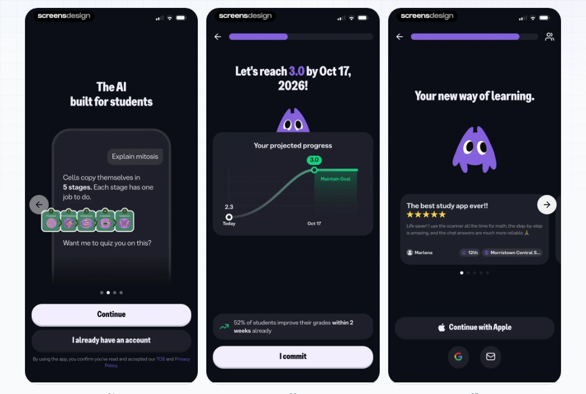

**Steal this**
- **"I commit"** as the button before the account, a small promise the student makes to themselves. For Wael: "⁧نتفاهمو؟ 10 دقايق في النهار حتى للباك⁩" → **"⁧تفاهمنا⁩"**.
- **A peer review card from a student the same age** at the sign-up moment.

**Avoid.** Grade predictions the product can't back up. For Wael, show the real Bac date and the real number of chapters, never a made-up grade curve.

## MENA and Tunisian education apps

> These apps publish little about their first launch, and none of them has a public recording on ScreensDesign. What follows is limited to what their store pages and websites show. I could not find public first-launch material for Nafham or Lamsa, so they are left out rather than guessed at.

### 13. Abwaab (Jordan, Egypt, Iraq, Saudi Arabia)

**What's visible.** The App Store listing targets grades 4–12 and says the learning journey is tailored to **the country curriculum you choose** (Egypt, Jordan, Iraq, Saudi Arabia). The screenshots show a Free vs Paid table (League, Lessons, Tests, Practice, Morshed mentor, Q&A), teacher video lessons with Arabic chapter lists, and a weekly schedule from a "Morshed" mentor who follows up over WhatsApp. There is also an Abwaab League leaderboard ([App Store](https://apps.apple.com/jo/app/abwaab/id1623367993?l=en-GB)). From the store listing, the order is country, then curriculum, then grade, then content. A reply to a Moroccan user on the listing says there is no content for Morocco yet, so a country picker needs a "not available yet" state.

 — apps.apple.com")

**Steal this**
- **A human mentor as the promise.** A WhatsApp follow-up from a real person matters a lot in the region. Wael's live teachers can be the "what you get when you sign up" line.
- **A league from day one**, already familiar to MENA students.

### 14. Noon Academy (Saudi Arabia, Pakistan, Egypt)

**What's visible.** "Full marks with friends." The home screenshot opens on **"Welcome, Grade 10 ▾"**, so the grade sits in the header as a dropdown and can be changed at any time. Each live course card shows a **"Join for free"** button and a social line ("100 students joined"). Live classes with a whiteboard and peers are the hero ([App Store](https://apps.apple.com/sa/app/id1214874641?l=en-GB)). One review notes a college picker with only one option, a reminder to test every branch of a picker.

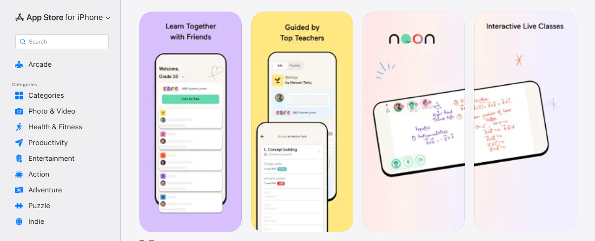

**Steal this**
- **Keep the level in the header as a chip** ("3ème Sciences ▾") after onboarding, so a wrong pick is never a dead end.
- **Social proof in numbers on live classes**: "⁧12 تلميذ من 3ème Sciences مسجلين في الحصة هذي⁩". Use only real numbers from the data.

### 15. TakiAcademy (Tunisia), the local benchmark

**What's visible.** The website calls itself the first online learning platform in Tunisia (since 2013), covering 4ème primaire to the Bac, in Arabic with an Arabic-script logo. The main CTAs are **"⁧سجل مجانا⁩"** (register for free) and "⁧ابدأ الآن⁩" (start now) ([takiacademy.com](https://www.takiacademy.com/)). The register page (French UI) asks for **"Email ou numéro de téléphone"** and a password, plus terms, with Google as the only alternative. It is the first thing you see, with no taste of content ([app.takiacademy.com/register](https://app.takiacademy.com/register)).

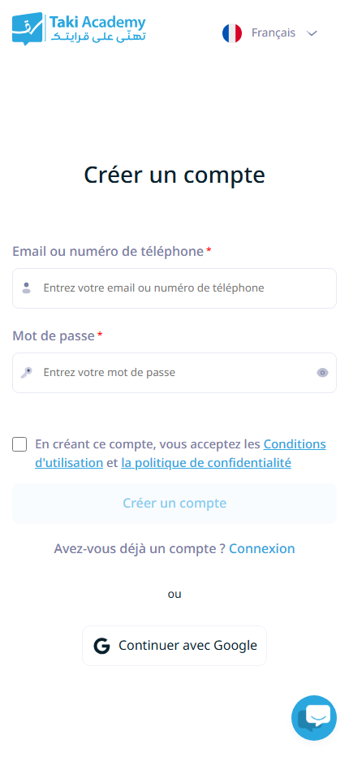

**Steal this**
- **Phone number as a first-class sign-up option** next to Google. Many Tunisian 15-year-olds use their phone number more than an email address.

**Avoid / opportunity.** Account before anything. This is exactly where Wael can be different: let the student play a real programme question first.

## Non-education apps famous for onboarding

### 16. Headspace: a taste of the product inside onboarding

**Flow.** An animated orange character exhaling ("Breathe out"), then "Create an account" right away (Apple, Google, Facebook, email, SSO), then value slides ("Science-backed meditation"), a few questions, and a trial paywall at about 1:04 with a very clear timeline. Then, before you even reach home, **"Let's take three breaths together"**: a guided breathing moment that delivers the product's core benefit ([ScreensDesign](https://screensdesign.com/showcase/headspace-meditation-sleep)).

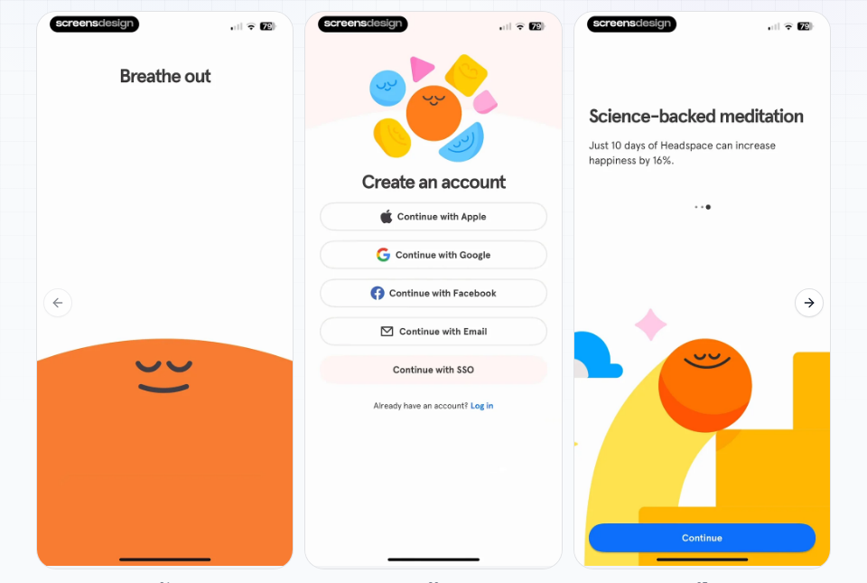
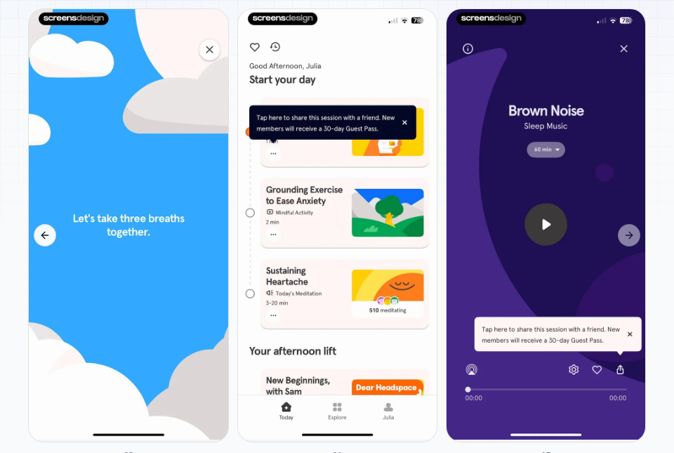

**Steal this.** **The splash itself does something** (the character breathes). Wael's splash can be the character waving, with a sound, not a static logo.

**Avoid.** The account wall as the second screen.

### 17. Finch: hatch an egg and you're attached

**Flow.** "Finch: your new self-care best friend," then **"Hatch a new pet"**. An egg wobbles and cracks, and the bird says caring things in a speech bubble while a "+5.5 Compassion" bubble pops. Questions and plan generation follow, then a paywall with a Today / Day 5 / Day 7 timeline. Then home with confetti and **"Woohoo! First time completion!"** on your first goal ([ScreensDesign](https://screensdesign.com/showcase/finch-self-care-pet)).

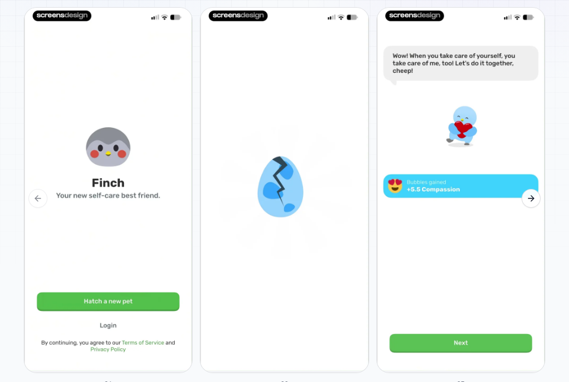
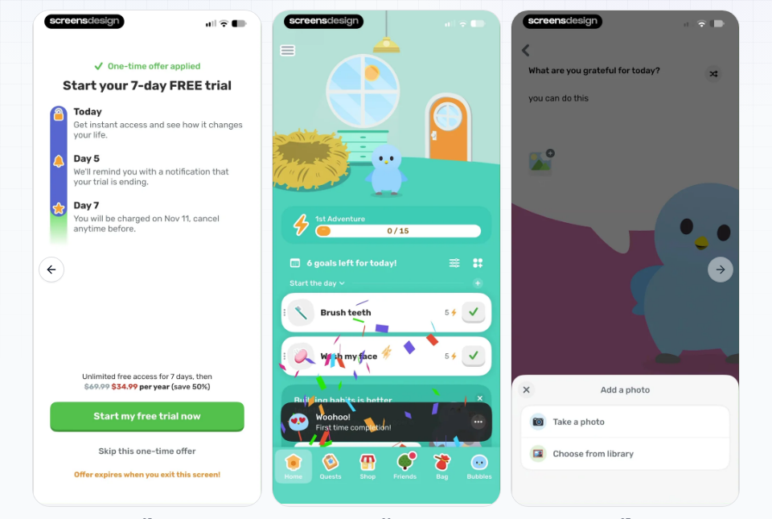

**Steal this**
- **Something is born because of you.** A Wael version: the subject badge "wakes up" (its eyes open and follow the finger) when the student picks their favourite subject, and it is theirs to keep if they sign up.
- **"First time" celebrations** for the first correct answer.

**Avoid.** "Skip this one-time offer" with "Offer expires when you exit this screen". That kind of pressure doesn't fit a school product for minors.

### 18. Noom: the long quiz, and the dark patterns to skip

**Flow.** "Sign up for free" (email and password) early, then a very long quiz (ScreensDesign counts 77 steps) with multi-select goals, a "Calculating weight loss pace… 66%" bar, a "2x" comparison chart, a personalised plan with a target date, and a 15-minute countdown to "reserve" the plan ([ScreensDesign](https://screensdesign.com/showcase/noom-weight-loss-food-tracker)).

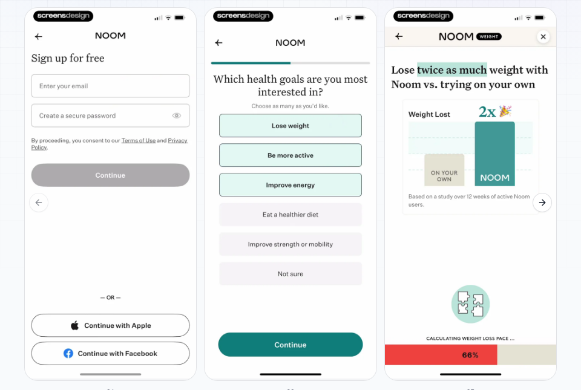

**Steal this.** **Interleave a "why this matters" fact screen between questions** to give the student a breather. One fact, not ten.

**Avoid.** Fake "calculating" progress, countdown timers and very long questionnaires.

### 19. Spotify: a picker grid that personalises the home screen

**Flow.** "Sign up to start listening" (email, Google, Facebook, Apple), a notification prompt, then "Choose 3 or more artists" and "Now choose some podcasts". These are grids of round or square covers with a search bar on top, and each pick loads more similar suggestions. A floating **Done** button appears once you have enough ([ScreensDesign](https://screensdesign.com/showcase/spotify-music-and-podcasts)).

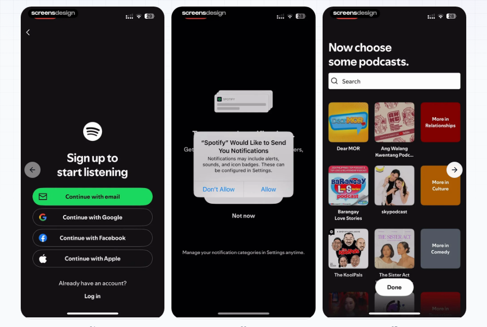

**Steal this.** **The favourite-subject picker as a grid of illustrated subject badges**, filtered by the chosen section, with the CTA appearing only after one pick. Pinterest's topic picker and Tinder-style swipes are the same idea. A swipe ("⁧نحبها / ما نحبهاش⁩") could be a fun alternative to a grid, but a grid is faster for 6–9 subjects.

### 20. Duolingo ABC: a character picker that creates attachment

**Flow.** "Learn to read for free," then "Who's learning to read?" (parent or teacher), then **"Choose a character for Mika"**: a 3-column grid of round animal avatars. A short cinematic follows (Duo flying a blimp), then a map with the first lesson node and a gold coin burst when it is done. It is a long setup that includes creating a password at about 1:17 before the first lesson ([ScreensDesign](https://screensdesign.com/showcase/learn-to-read-duolingo-abc)).

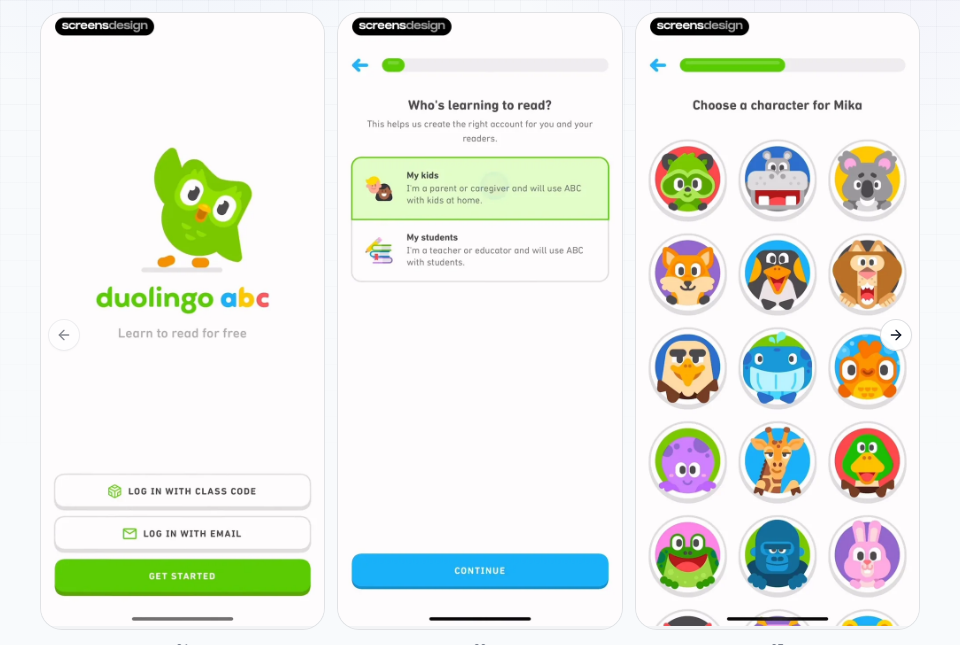

**Steal this.** **A tiny cinematic between setup and the game**: 2 seconds of Wael running to a door labelled with your subject. It tells the student "the game starts now".

## Also checked (briefly)

- **Gauth** offers a 3-day trial during onboarding that gates the core features before any use ([ScreensDesign](https://screensdesign.com/showcase/gauth-ai-study-companion)). Paywall first, so avoid.
- **Calm** asks for notification and tracking permissions on the very first screen, and requires sign-up after a short quiz ([ScreensDesign](https://screensdesign.com/showcase/calm)). Avoid cold permission prompts.
- **Drops** has playful questions (a time-of-day slider) but puts a paywall and permission prompts before any gameplay ([ScreensDesign](https://screensdesign.com/showcase/drops-language-learning-games)).
- **Sololearn, Prodigy Math, Synthesis, Socratic, Byju's, Nafham, Lamsa**: no public first-launch recording or teardown I could verify, so they are not described here.

## Comparison table

| App | Questions before sign-up | Mini-lesson / quiz before sign-up | Where the gate is | What's kept after sign-up |
|---|---|---|---|---|
| Duolingo | 5–7 (language, source, why, daily goal, level) | Yes: first lesson or placement test | Soft wall after the first lesson ("Later" allowed), more soft walls, then a hard wall after several lessons | Course, XP, streak, level; unlocks leaderboards |
| Brilliant | ~4 (role, interest, math level shown as problems, goal) | Partly: level is picked by recognising real problems | After the questions, before the first lesson, then a paywall | Personalised learning path |
| Mimo | 3–4 (why, what, experience slider) | No (lesson after the paywall) | Paywall before the first lesson | Chosen path, streak, coins |
| Kahoot! | 1–2, asked as quiz tiles | The setup is a quiz | Right after the quiz-style setup (username) | Username, avatar, kahoots |
| Speak | 3, asked by voice | No (a conversation, not a lesson) | Soft paywall after the conversational quiz | Personalised course recommendation |
| Babbel | 5+ (language, motivations, skills, level) | No | Mandatory sign-up after the questions, then a paywall | Learning plan from the answers |
| Busuu | 0 | No | Screen 2 (web sign-up form) | Everything that follows |
| Elevate | Several yes/no goals | Yes: a 1–2 minute skill test | Paywall at the end of onboarding | Training plan, skill levels |
| Khan Academy | 0 | No | Screen 1 | Chosen courses, mastery points |
| Photomath | 0 (tour only) | Yes: first scans are free | Contextual paywall on "Why?" | Scan history, bookmarks |
| Quizlet | 0 | No | Screen 2 (Google sign-in), then a paywall | Sets, progress |
| Knowunity | Goals + target grade | No | After "I commit" and a review card | Goal, study plan |
| Abwaab | Country, curriculum, grade (from the store listing) | Not documented | Not documented | Curriculum-tailored journey, league |
| Noon Academy | Grade (header dropdown) | Not documented | Not documented ("Join for free" on classes) | Grade, joined classes |
| TakiAcademy | 0 | No | Screen 1 (email or phone + password) | Access to the platform |
| Headspace | 0 before the account, a few after | Breathing taste after the account | Screen 2 | Plan, sessions, streak |
| Finch | A few after hatching the pet | Hatching is the interactive taste | After the plan, at the paywall | Your pet, goals |
| Noom | Dozens (77 steps) | No | Early sign-up, paywall after the plan | Plan, goal date |
| Spotify | 0 before the account | No | Screen 1–2 | Artist and podcast taste profile |
| Duolingo ABC | 2–3 (who, character) | No (password before the first lesson) | Before the first lesson | Child profile, character, map progress |

## Patterns that keep coming back (ranked by fit for Wael)

1. **Value before the account, with a soft wall and a quiet "Later"** (Duolingo; Photomath gating the "why"; Headspace's breathing taste). It fits the brief best and has the strongest evidence (+20% DAU at Duolingo).
2. **A mascot that talks on every screen** (Duolingo, Mimo, Finch, Knowunity, Speak's tutor). Wael already has the character, so make him the narrator of every step, not just the welcome.
3. **Questions asked in the game's own language**: answer tiles, sounds, instant "Great!" (Kahoot!, Speak). The pickers become the warm-up of the mini-game.
4. **Level check by recognition, not declaration** (Brilliant's problems, Elevate's test, Duolingo's placement). For Wael: a sample from each year on the level cards.
5. **Reflect answers back as a promise or a plan card** (Duolingo's "25 words", Speak's "what we learned", Knowunity's goal). One card, honest numbers.
6. **A celebration result screen built on one big number, plus honest stats** (Brilliant, Speak, Duolingo, Mimo, Finch's confetti). It sets up the "keep it" ask.
7. **A progress bar across onboarding** (nearly every app). Students see "3 steps left" and keep going.
8. **Something born or unlocked that is "yours"** (Finch's egg, Duolingo ABC's character, a streak lit on day 1). It creates loss aversion at the sign-up moment.
9. **Picker grids with illustrations, CTA after the first pick** (Spotify, Duolingo ABC). Wael has the subject badges for this.
10. **A small commitment button** ("I commit", Duolingo's daily goal). Useful, light.
11. **A stack of one-tap sign-ins** (everyone). Locally, add phone number (TakiAcademy).
12. **A trial timeline when money is involved** (Headspace, Quizlet, Finch, Drops). Only relevant if Wael shows offers later, never inside the first-launch game.
13. **Urgency timers, one-time offers, fake "calculating"** (Noom, Finch). Last place: don't use them with teenagers.

## The Wael remix

A proposed first launch: about 3 minutes, 9 screens, one soft wall, one hard wall. Derja lines are drafts for the copywriter. Mechanics follow the `play` skin (chunky lipped tiles, one lime moment per screen, sound on the same frame as the visual).

1. **Splash (≈1.5 s).** The Wael logo, then the character pops up and waves, with a short sound. No buttons. _(Headspace's living splash.)_
2. **Welcome.** Wael in a speech bubble: "⁧عسلامة! أنا وائل 👋 في 3 دقايق نعرفو مستواك ونلعبو شوية.⁩" Primary **"⁧يلا نبداو⁩"**, small link "⁧عندي حساب⁩". A progress bar appears at the top and stays. _(Duolingo.)_
3. **Level.** "⁧في أما سنة تقرا؟⁩" with six chunky tiles, 1ère → Bac. Each tile shows a one-line sample from that year's programme (e.g. 1ère "2x + 3 = 7", Bac "lim (eˣ−1)/x"). Tapping plays a "pop" sound and Wael reacts in one line (Bac: "⁧الباك؟ ما تخافش، معاك 💪⁩"). _(Brilliant + Kahoot!.)_
4. **Section (from 2ème only).** 2ème: Sciences, Lettres, Économie & Services, Technologies de l'informatique. 3ème/Bac: Mathématiques, Sciences expérimentales, Sciences techniques, Économie & Gestion, Sciences de l'informatique, Lettres, Sport. Same tile style, with the section's icon. 1ère skips this screen, and the progress bar shrinks accordingly.
5. **Favourite subject.** "⁧شنوة المادة اللي تحبها أكثر؟⁩" A grid of the illustrated subject badges, filtered to that section. The chosen badge **wakes up** (eyes open and follow the finger, a small bounce), and the CTA "⁧هيا نلعبو⁩" appears only after a pick. _(Spotify's picker + Finch's hatch.)_
6. **"Here's what Wael understood" card + the cost.** "⁧3ème Sciences · Physique ❤️ — 3 أسئلة، دقيقتين تقريب.⁩" One short cinematic beat: Wael runs through a door labelled Physique. _(Speak + Elevate + Duolingo ABC.)_
7. **Mini-game: 3 screens.** Q1 warm-up, Q2 medium, Q3 a **"⁧سؤال على طريقة الباك/الامتحان⁩"** labelled with its real chapter ("⁧من برنامج 3ème Sciences · الفصل 2⁩"). Instant feedback: a lime flash and chime when right, a gentle shake when wrong, and a short explanation in a Mimo-style bottom sheet with Wael. A wrong answer never blocks: the correct answer is always shown. The full step-by-step solution is locked behind "⁧شوف الحل كامل⁩", which later becomes a sign-up reason. _(Mimo, Photomath.)_
8. **Result / reward.** One big number (stars or XP, earned in a burst), honest stats ("⁧2/3 صحاح · دقيقة و40 ثانية⁩"), the woken badge as an earned sticker, day 1 of the streak lit by a swipe, and the next chapters shown as **"?" mystery cards**. No fake percentiles, no predicted grades. _(Brilliant, Speak, Duolingo, Elevate.)_
9. **Soft wall (bottom sheet over the result).** Wael: "⁧باهي برشا! اعمل حساب باش نحفظولك النجوم والستيكر والمستوى متاعك.⁩" Buttons: **Google**, **⁧رقم التليفون⁩**, **Email**, then a small quiet **"⁧مبعد⁩"** (Later). Say exactly what is kept: level, section, subject, the stars, the sticker, the streak, and the personalised path. _(Duolingo's soft wall + TakiAcademy's phone option.)_
10. **Hard wall on "play again".** If the student taps "Later" and then **"⁧العب جولة أخرى⁩"** (or opens a mystery card), the account is required: "⁧جولة أخرى؟ اعمل حسابك في 20 ثانية وكمّل.⁩" The game state stays on screen behind the sheet, so they can see what they would lose. _(Duolingo's hard wall.)_
11. **After sign-up.** A celebration: the sticker flies into the profile, plus "⁧مرحبا بيك في Wael Academy⁩". Then a warmed-up notification ask ("⁧نبعثلك سؤال صغير كل نهار؟⁩"), never a cold system prompt. Then home, with the level chip "3ème Sciences ▾" in the header. _(Noon's header chip.)_

**What's unique to Wael**
- **The Tunisian programme is the proof.** Every question carries its real year, section and chapter label. That is something global apps can't fake and local competitors don't show before sign-up.
- **Sections are a real branch**, not a cosmetic choice: they change the subjects grid and the questions, and they only appear from 2ème.
- **Bac stakes, handled kindly.** Show the real Bac date and how many chapters are left, never invented grade predictions. Bac students get the reassuring line, not pressure.
- **The Wael character** narrates every step in a speech bubble, reacts to each choice, and lives on the result and sign-up screens. He is the one asking, which softens the ask.
- **Derja tone**: short, warm, a bit cheeky, like Duolingo's voice but Tunisian ("⁧باهي برشا⁩", "⁧يلا⁩", "⁧ما تخافش⁩"), with formal Arabic kept for the actual question text.
- **Live classes as the sign-up hook**: "the next live Physique class for 3ème Sciences is Tuesday at 18:00, sign up to join", using real data from the schedule.
- **Phone-number sign-up** next to Google, and a parent-friendly note for under-18s if the legal team needs it.

_Image credits: phone-screen strips from the public showcase pages on [screensdesign.com](https://screensdesign.com/showcase/) (one link per app above); Duolingo soft-wall and placement screens from [Appcues GoodUX](https://goodux.appcues.com/blog/duolingo-user-onboarding); Abwaab and Noon Academy from their App Store listings; TakiAcademy from [takiacademy.com](https://www.takiacademy.com/) and its public register page. Duolingo test results from [First Round Review](https://review.firstround.com/the-tenets-of-a-b-testing-from-duolingos-master-growth-hacker). All captured 15 Nov 2026 for internal design research._
