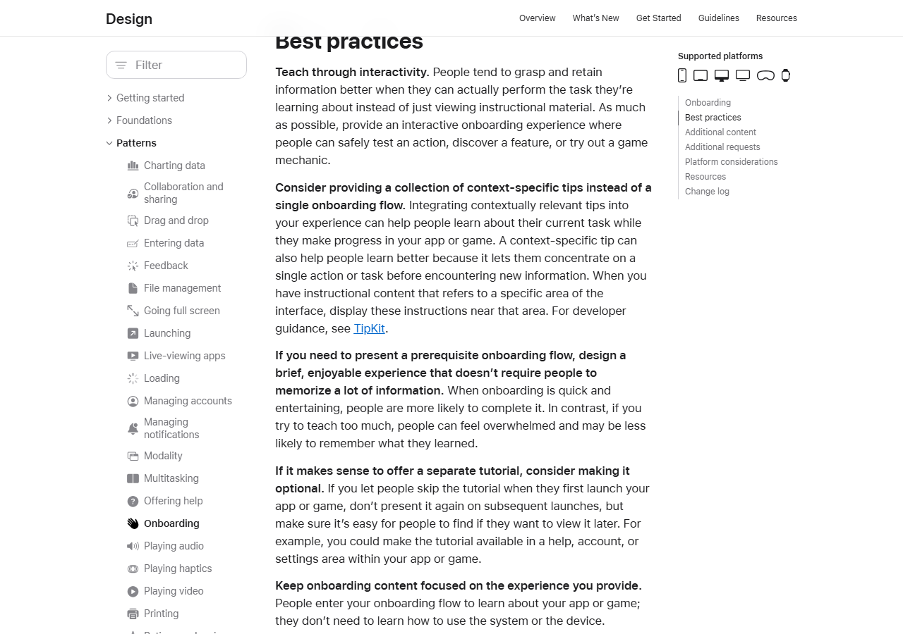
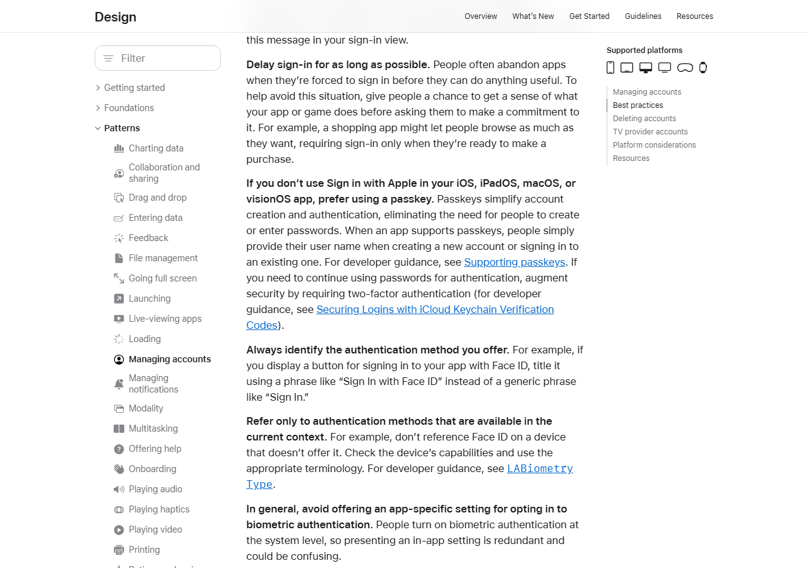
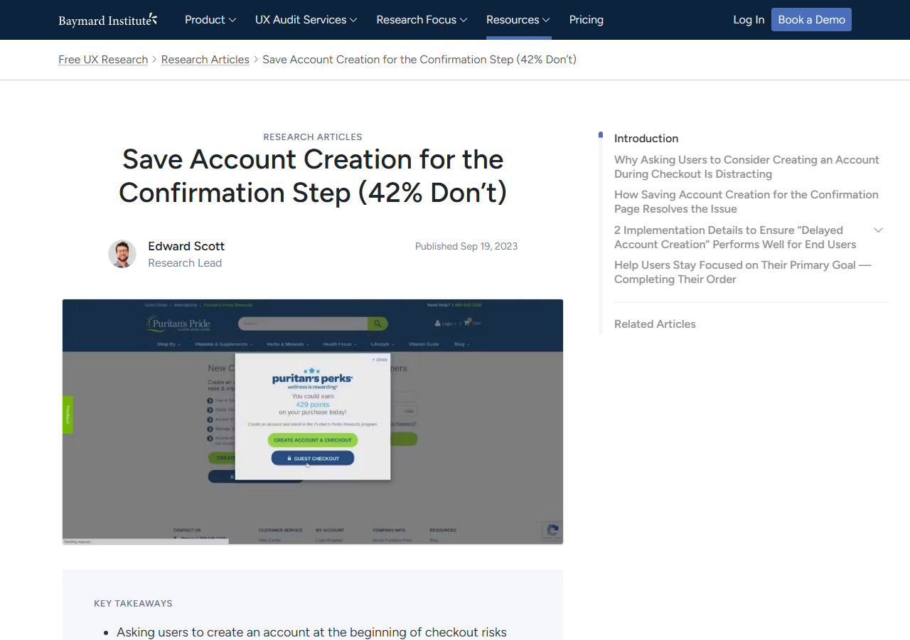
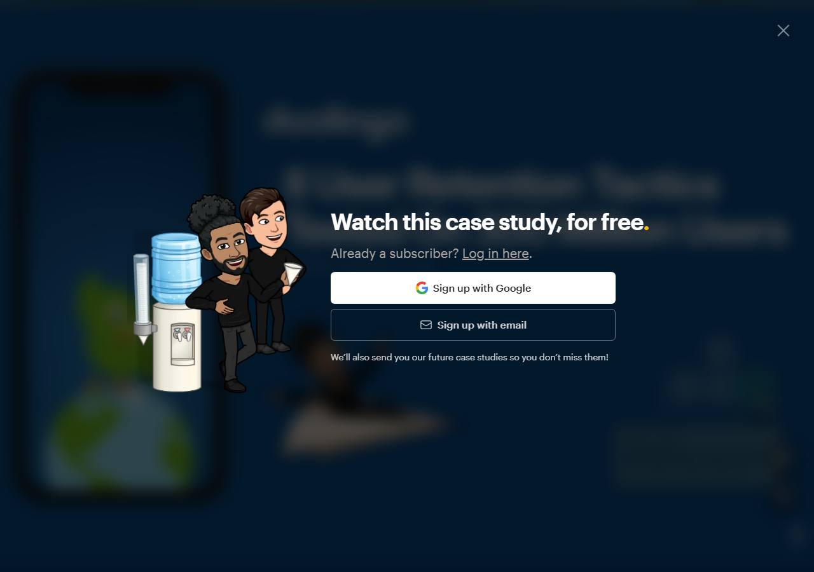
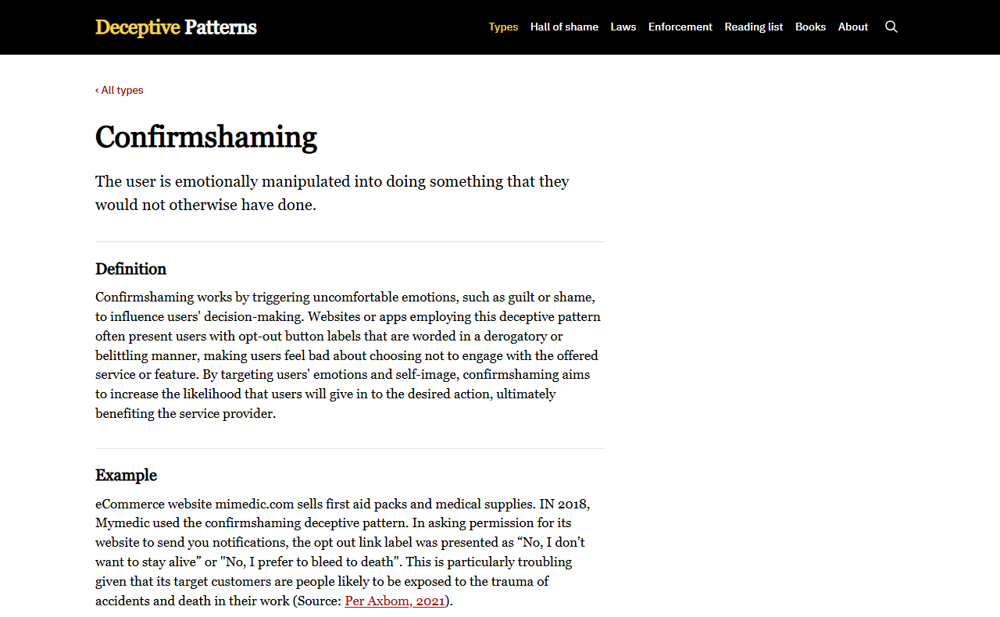
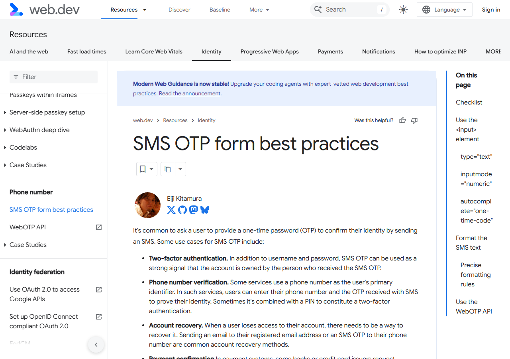

# First-launch onboarding — UX best practices for Wael Academy

Research brief for the first-launch flow of the Wael Academy student app (Arabic RTL, Tunisian Derja tone, gamified `play` skin). It collects what official guidelines and published research say, turns each theme into concrete advice for this flow, and ends with a verdict on the proposed flow and a recommended version.

Proposed flow under review: splash → welcome from Wael (the mascot) → pick a level (1ère, 2ème, 3ème, Bac; from 2ème a section too) → pick a favourite subject → a 3-screen mini-game with questions from the official programme → result and reward → to play again or keep progress, create an account.

_Compiled 15 November 2026. Sources are linked inline. Legal points are research, not legal advice._

## The 10 rules that matter most

1. **Value first, account later.** Let the student play and win before you ask for anything. Apple says to "delay sign-in for as long as possible"; Duolingo got about 20% more daily active users by moving sign-up a few steps later ([Apple HIG](https://developer.apple.com/design/human-interface-guidelines/managing-accounts), [First Round Review](https://review.firstround.com/the-tenets-of-a-b-testing-from-duolingos-master-growth-hacker)).
2. **Only ask what changes what they see next.** Level, section and subject change the questions, so they earn their place. Anything else waits. Say why you are asking, one question per screen, with back always available ([NN/g](https://www.nngroup.com/articles/mobile-app-onboarding/)).
3. **Teach by doing, not by slides.** The mini-game is the onboarding. No carousel of feature cards ([Apple HIG onboarding](https://developer.apple.com/design/human-interface-guidelines/onboarding), [NN/g on tutorials](https://www.nngroup.com/articles/onboarding-tutorials/)).
4. **The first game is built to be won.** Easy first question, mostly-right overall, explanation after every answer, no timer ([Van der Kleij et al. 2015](https://doi.org/10.3102/0034654314564881), [WCAG 2.2.1](https://www.w3.org/WAI/WCAG22/Understanding/timing-adjustable.html)).
5. **Honest progress, a real peak, a good ending.** Show true step counts, put the celebration at the result, and make the account step feel like a save, not a toll ([Kahneman et al. 1993](https://doi.org/10.1111/j.1467-9280.1993.tb00589.x), [Nunes and Drèze 2006](https://doi.org/10.1086/500480)).
6. **The account is how you keep what you made.** Frame sign-up as "save your XP, badge and level", and carry guest progress into the account intact ([Baymard](https://baymard.com/blog/delayed-account-creation), [Firebase](https://firebase.google.com/docs/auth/web/anonymous-auth)).
7. **Soft wall before hard wall, and never shame.** Offer "Later" at the first prompt; hard-gate only after more value. No guilt-trip opt-outs, no fake timers ([First Round Review](https://review.firstround.com/the-tenets-of-a-b-testing-from-duolingos-master-growth-hacker), [Deceptive Patterns](https://www.deceptive.design/types/confirmshaming)).
8. **Ask for the minimum, in the way Tunisians already sign in.** Phone number + SMS code (auto-filled), first name, done. No password on day one. Offer Google and Apple ([web.dev](https://web.dev/articles/sms-otp-form), [App Store 4.8](https://developer.apple.com/app-store/review/guidelines/)).
9. **Most of your users are minors under Tunisian law.** Processing a child's data needs a guardian's consent (Law 2004-63, art. 28). Build a parent step that does not block the first game, and keep defaults high-privacy ([ICO Children's Code](https://ico.org.uk/for-organisations/uk-gdpr-guidance-and-resources/childrens-information/childrens-code-guidance-and-resources/age-appropriate-design-a-code-of-practice-for-online-services/)).
10. **Wael guides, never blocks; sound and motion obey the user.** One short line per bubble, tap to continue, skip always visible. Respect silent mode and reduced motion, 44 px targets, everything mirrored for RTL ([Apple audio](https://developer.apple.com/design/human-interface-guidelines/playing-audio), [Apple RTL](https://developer.apple.com/design/human-interface-guidelines/right-to-left)).

## 1. What first-launch onboarding is for

**Onboarding is a cost, so it has to earn its place.** Nielsen Norman Group's advice is to avoid dedicated onboarding where possible and to fix usability instead, because every onboarding screen adds interaction cost, even when skipped. It identifies three kinds of onboarding content: feature promotion, customization and instructions. Feature promotion at first launch is the weakest; content customization (choosing a language, a level) is the most defensible, provided it is brief, explains why the data is needed and can be skipped ([NN/g, Mobile-App Onboarding](https://www.nngroup.com/articles/mobile-app-onboarding/)).

**Slide decks do not work; doing does.** NN/g reports that deck-of-cards tutorials did not improve task performance in its research; people skip them and forget them, because the guidance is shown out of context. Help should be "pulled" by a need, not "pushed" at launch ([NN/g, Onboarding Tutorials vs. Contextual Help](https://www.nngroup.com/articles/onboarding-tutorials/)). Apple's onboarding guidance says the same in one line: design a flow that is "fast, fun, and optional", and teach through interactivity so people "safely test an action" or "try out a game mechanic" ([Apple HIG, Onboarding](https://developer.apple.com/design/human-interface-guidelines/onboarding)).

**Splash: short.** Apple: if a splash is needed, show it only long enough to be absorbed at a glance, and postpone non-essential setup so people can start right away ([Apple HIG, Onboarding](https://developer.apple.com/design/human-interface-guidelines/onboarding)).

**Contextual beats welcome-placement when you want sign-ups.** Android's onboarding pattern contrasts a welcome placement (all setup up front, higher risk of losing people before they see the app) with contextual onboarding, which "enables patterns like permission priming" and is "best used when you want to provide a preview to entice sign-ups" ([Android Developers, Authentication and onboarding](https://developer.android.com/design/ui/mobile/guides/patterns/onboarding)).

> **For Wael:** the proposed flow is already on the right side of this research: it has no feature carousel, and the mini-game is a real "learn by doing" moment. Keep it that way: no "here is what Wael Academy offers" slides before the game. Show the offer (live classes, recordings, exercises) after the result, as the answer to "what next?". Keep the splash under about 1.5 s with no tap required.

## 2. Value before sign-up (gradual engagement)

**The principle.** Luke Wroblewski's "gradual engagement": postpone registration until the moment people must register to go further, and let them use the product first. He also warns that simply splitting a sign-up form across more screens "delights no one" ([Wroblewski, Sign Up Forms Must Die, A List Apart](https://alistapart.com/article/signupforms/)).

**Platform guidance agrees.** Apple: "Delay sign-in for as long as possible", because people often abandon apps forced to sign in before doing anything useful; explain the benefits of an account in the sign-in view ([Apple HIG, Managing accounts](https://developer.apple.com/design/human-interface-guidelines/managing-accounts)). Android: "show the value of the app before asking for device permissions or to create an account" ([Android Developers](https://developer.android.com/design/ui/mobile/guides/patterns/onboarding)). App Store review guideline 5.1.1(v) asks apps without significant account-based features to work without a login ([App Store Review Guidelines](https://developer.apple.com/app-store/review/guidelines/)).

**Evidence.**
- Duolingo: moving the sign-up screen back a few steps "led to about a 20% increase in DAUs". Replacing a big red "Discard my progress" button with a quiet "Later" also helped. Duolingo now uses several skippable soft walls and one hard wall after a few lessons, and found the hard wall performs much worse without the soft walls priming it ([First Round Review, interview with Gina Gotthilf](https://review.firstround.com/the-tenets-of-a-b-testing-from-duolingos-master-growth-hacker)).
- NN/g usability testing: users are rarely more annoyed than at a login wall; walls have a high interaction cost and break the reciprocity principle (give first, then ask) ([NN/g, Login Walls Stop Users in Their Tracks](https://www.nngroup.com/articles/login-walls/)).
- Baymard (e-commerce): forced account creation is one of the main reasons for checkout abandonment, about 19% of abandoners in its surveys ([Baymard, Reduce cart abandonment](https://baymard.com/blog/reduce-cart-abandonment)). Asking for the account after the order, on the confirmation page, beat asking at the start, because the user's goal was done and the data already entered. Baymard recommends listing 3–5 concrete benefits there ([Baymard, Save account creation for the confirmation step](https://baymard.com/blog/delayed-account-creation)).

**Carrying guest progress over.** Technically this is a solved problem: start the guest on an anonymous identity, store their progress against it, then link the phone or social credential to that same identity when they sign up, so nothing is copied or lost. Firebase documents this as `linkWithCredential` and warns to handle the "credential already in use" case (a returning user who signs in rather than signs up) ([Firebase, anonymous auth](https://firebase.google.com/docs/auth/web/anonymous-auth); [Firebase blog, best practices](https://firebase.blog/posts/2023/07/best-practices-for-anonymous-authentication)). Android adds the UX half: "Always clearly communicate what will happen with any progress" ([Android Developers](https://developer.android.com/design/ui/mobile/guides/patterns/onboarding)).

: high interaction cost, breaks reciprocity. Screenshot, cookie banner removed.")

> **For Wael:** asking at the result is the right moment, it is the e-commerce confirmation page of this flow. Two changes make it work better. (1) Make the first prompt a **soft wall**: primary "save my result", secondary "Later". Let a guest play one more round, then hard-gate on things that truly need an account (keeping a streak across days, booking a live class, a third game). (2) Keep the guest's XP, badge, level and subject on an anonymous id from the first tap, and show "your 40 XP and the badge are saved" on the first screen after sign-up. If someone with an existing account signs in instead, merge or ask; never wipe silently.

## 3. Personalisation questions

**How many.** No guideline gives a magic number. The consistent rules are: ask only what the product immediately uses, keep it brief, explain why, offer skip ([NN/g](https://www.nngroup.com/articles/mobile-app-onboarding/)); postpone non-essential setup and provide sensible defaults ([Apple HIG](https://developer.apple.com/design/human-interface-guidelines/onboarding)); "collect only critical user information" ([Android Developers](https://developer.android.com/design/ui/mobile/guides/patterns/onboarding)). Survey research shows the cost of length: in a web-survey experiment, 75% started a survey announced as 10 minutes versus 65% for 20 minutes, and answers got sloppier towards the end of longer versions ([Galesic and Bosnjak 2009, Public Opinion Quarterly](https://doi.org/10.1093/poq/nfp031)). Hick's law (decision time grows with the number of choices) is the usual argument for short option lists ([Growth.Design, Duolingo case study](https://growth.design/case-studies/duolingo-user-retention)).

**Show the reason, show progress, let them go back.** Android recommends steppers or progress indicators so people know how many steps remain, and warns against progress that could be mistaken for decoration. It also asks for a clear skip and a "resume later" that keeps what was entered ([Android Developers](https://developer.android.com/design/ui/mobile/guides/patterns/onboarding)). Duolingo's goal screen is a good model: a progress bar, a back arrow, a pre-selected sensible default and the mascot saying "You can always change goals later" ([Appcues GoodUX, Duolingo](https://goodux.appcues.com/blog/duolingo-user-onboarding)).

**Placement versus self-report.** Duolingo asks beginners and returning learners to self-select, and offers an optional adaptive placement test to the latter ([Appcues GoodUX](https://goodux.appcues.com/blog/duolingo-user-onboarding)). Self-report is fine when the answer is a fact the user knows, like a school year.

<figure><figcaption>Duolingo: one question, a default, a progress bar, back, and a one-line bubble saying the answer can change later. Via <a href="https://goodux.appcues.com/blog/duolingo-user-onboarding" target="_blank" rel="noopener">Appcues GoodUX</a>.</figcaption></figure>
<figure><figcaption>Two big choices with the mascot in each card: start from basics or take a placement test. Via <a href="https://goodux.appcues.com/blog/duolingo-user-onboarding" target="_blank" rel="noopener">Appcues GoodUX</a>.</figcaption></figure>
<figure><figcaption>Android: a visible skip that says what is kept (your choices are saved, finish later). From <a href="https://developer.android.com/design/ui/mobile/guides/patterns/onboarding" target="_blank" rel="noopener">Android Developers</a>.</figcaption></figure>

> **For Wael:** level, section and subject are exactly the "content customization" NN/g endorses, because each one changes the questions. Make it **two screens, not three**: level (4 big cards) then section only if the level has sections; subject comes right after as the "pick your game" moment. Pre-select nothing for level (it is a fact), but give each screen one line of why, in Derja, e.g. "⁨باش نعطيوك أسئلة على قدّك⁩" (so the questions fit your level). Back is always there, and answers are editable later in the profile. Add a "⁨اختارلي إنت⁩" (you pick for me) option on the subject screen for students who freeze. **Check the section list per level:** in 2ème année the tracks are fewer (Sciences, Technologies de l'informatique, Économie et services, Lettres, Sport); the Maths / Sciences expérimentales / Technique split happens from 3ème ([La Presse, Apr 2026](https://www.lapresse.tn/?p=4324841); [2ème programmes, 2005](https://edutice.archives-ouvertes.fr/edutice-00560705/file/a1002f_2.pdf)). Confirm with the current Ministry programme before building the chips.

## 4. The psychology that pulls people forward, and where it stops

Each effect below has a real use in this flow and an abuse to avoid.

| Effect | What the research found | Honest use for Wael | Line not to cross |
|---|---|---|---|
| **Endowed progress** | Car-wash cards: 10 stamps with 2 pre-filled were completed by about 34% of customers vs 19% for an empty 8-stamp card, same effort ([Nunes and Drèze 2006](https://doi.org/10.1086/500480)) | Count the steps the student really did: "level ✓ subject ✓" fill the first segments of the bar | Pre-filling progress for steps nobody did, or a bar that jumps to make it look nearly finished |
| **Goal gradient** | People speed up as a reward gets close; coffee-card members bought more often near the free coffee ([Kivetz, Urminsky and Zheng 2006](https://doi.org/10.1509/jmkr.43.1.39)) | "Last question!" on Q3; the save step shown as the final, short step | Moving the goal post after they arrive ("one more step… and one more") |
| **IKEA effect** | People value what they built themselves more, but only when they finished it ([Norton, Mochon and Ariely 2012](https://doi.org/10.1016/j.jcps.2011.08.002)) | The result card is theirs: their score, their badge, their chosen subject. Saving it means something | Holding it hostage ("sign up or lose everything now") |
| **Zeigarnik / Ovsiankina** | A 2025 meta-analysis found no general memory advantage for unfinished tasks (Zeigarnik), but a reliable urge to resume interrupted tasks (Ovsiankina) ([Ghibellini and Meier 2025](https://doi.org/10.1057/s41599-025-05000-w)) | End on a visible next step: "Level 2 of Physique unlocked" | Manufactured cliffhangers that only an account can close |
| **Peak-end rule** | People judge an experience by its most intense moment and its end; participants preferred a longer cold-water trial that ended slightly better ([Kahneman et al. 1993](https://doi.org/10.1111/j.1467-9280.1993.tb00589.x); [NN/g](https://www.nngroup.com/articles/peak-end-rule/)) | Put the peak at the result; make the end of sign-up a second small high ("saved!") | Ending the flow on a form, an error or a guilt message |
| **Commitment and consistency** | People who agree to a small request are more likely to agree to a larger related one ([Freedman and Fraser 1966](https://doi.org/10.1037/h0023552)) | Small, low-stakes choices first (level, subject, one answer), the account last | Tricking a "yes" (pre-ticked consent, a "Continue" that silently signs them up) |
| **Variable reward** | Unpredictable rewards are compelling, which is why habit-building products use them ([Eyal, Hooked](https://www.nirandfar.com/hooked/)); paid random rewards are linked to problem gambling ([Zendle and Cairns 2018](https://doi.org/10.1371/journal.pone.0206767)) | Small surprises: Wael reacts differently, a bonus fact, a rare sticker | Anything random that costs money, loot boxes, or streak-loss threats aimed at teens |

**The honesty line.** Confirmshaming means wording the "no" option to make people feel bad for declining ([Deceptive Patterns](https://www.deceptive.design/types/confirmshaming)). The FTC's staff report lists it with other dark patterns that obscure or subvert choice, including in children's apps ([FTC, Bringing Dark Patterns to Light, 2022](https://www.ftc.gov/reports/bringing-dark-patterns-light)). The UK Children's Code (standard 13) says not to use nudge techniques that lead children to give unnecessary personal data or weaken their privacy ([ICO, Nudge techniques](https://ico.org.uk/for-organisations/uk-gdpr-guidance-and-resources/childrens-information/childrens-code-guidance-and-resources/age-appropriate-design-a-code-of-practice-for-online-services/13-nudge-techniques/)). Duolingo's own data is the commercial argument: the neutral "Later" did better than "Discard my progress" ([First Round Review](https://review.firstround.com/the-tenets-of-a-b-testing-from-duolingos-master-growth-hacker)).

<figure style="overflow-x:auto">
<svg viewBox="0 0 1000 420" role="img" aria-labelledby="mc-t mc-d" xmlns="http://www.w3.org/2000/svg" style="display:block;width:100%;min-width:720px;height:auto;background:var(--panel)">
<title id="mc-t">Motivation across the onboarding steps</title>
<desc id="mc-d">Illustrative curve. Motivation rises through the mini-game and peaks at the result. With a hard account gate right after the result it drops sharply; with a soft save prompt and a short phone sign-up it stays high and ends on a second small peak.</desc>

<text x="40" y="34" class="mc-hd">Motivation through the flow (illustrative, not measured)</text>
<line x1="70" y1="350" x2="960" y2="350" class="mc-ax"/>
<line x1="70" y1="60" x2="70" y2="350" class="mc-ax"/>
<text x="20" y="200" class="mc-lb" transform="rotate(-90 20 200)">motivation</text>
<text x="80" y="378" class="mc-lb">Splash</text>
<text x="170" y="378" class="mc-lb">Wael</text>
<text x="250" y="378" class="mc-lb">Level</text>
<text x="335" y="378" class="mc-lb">Subject</text>
<text x="440" y="378" class="mc-lb">Q1</text>
<text x="520" y="378" class="mc-lb">Q2</text>
<text x="600" y="378" class="mc-lb">Q3</text>
<text x="665" y="378" class="mc-lb">Result</text>
<text x="760" y="378" class="mc-lb">Account</text>
<text x="870" y="378" class="mc-lb">Home</text>
<path class="mc-a" d="M90 260 C150 250 200 245 260 250 S350 240 360 235 S430 200 450 195 S520 175 530 170 S600 140 610 135 S680 95 690 92 C730 110 750 260 780 285 S880 300 900 305"/>
<path class="mc-b" d="M90 260 C150 250 200 245 260 250 S350 240 360 235 S430 200 450 195 S520 175 530 170 S600 140 610 135 S680 95 690 92 C730 105 750 150 780 150 S860 110 900 105"/>
<circle cx="690" cy="92" r="9" class="mc-pk"/>
<circle cx="900" cy="105" r="9" class="mc-pk"/>
<text x="560" y="78" class="mc-gate">peak: the win</text>
<text x="800" y="96" class="mc-gate">end: "saved!"</text>
<text x="790" y="275" class="mc-gate">hard gate, no "Later"</text>
<line x1="110" y1="408" x2="150" y2="408" class="mc-b"/><text x="158" y="413" class="mc-lb">Recommended: soft save + 2-field sign-up</text>
<line x1="560" y1="408" x2="600" y2="408" class="mc-a"/><text x="608" y="413" class="mc-lb">Hard gate right after the result</text>
</svg>
<figcaption>Drawn for this brief. The shape follows the peak-end rule and Duolingo's soft-wall finding; the heights are illustrative, not data.</figcaption>
</figure>

> **For Wael:** use all of these, openly. The progress bar counts real steps; "Last question!" is true; the result card belongs to the student; the auth screen says what the account keeps (XP, badge, level, the next lesson) and offers "⁨خلّيها بعد⁩" (later) in a calm secondary style. No countdowns, no "you'll lose everything", no pre-ticked boxes. The `play` skin's one lime moment per screen belongs on the result, which is the peak.

## 5. Quiz and mini-game UX for learning

**Feedback after every answer, with the why.** A meta-analysis of feedback in computer-based learning found elaborated feedback (an explanation) beats simply showing the correct answer, which in turn beats "right/wrong" alone, especially for higher-order learning ([Van der Kleij, Feskens and Eggen 2015](https://doi.org/10.3102/0034654314564881)). Feedback about the task and the method works; praise of the person ("you're so smart") adds little ([Hattie and Timperley 2007, The Power of Feedback](https://doi.org/10.3102/003465430298487)). Keep it specific, short and clear, and immediate for novices and hard items ([Shute 2008, Focus on Formative Feedback](https://doi.org/10.3102/0034654307313795)). Answering questions is itself a strong way to learn (the testing effect), so the mini-game is real teaching, not just a demo ([Roediger and Karpicke 2006](https://doi.org/10.1111/j.1467-9280.2006.01693.x)).

**Difficulty: they should mostly win.** In a theoretical model of learning, the optimal training accuracy was about 85% ([Wilson et al. 2019, Nature Communications](https://doi.org/10.1038/s41467-019-12552-4)); the author himself warns it was shown on simple right/wrong tasks and is not a grading target, so treat it as a direction, not a rule. For a first session, games go further: Growth.Design's Duolingo study describes a simplified "happy path" with lower difficulty for new and returning users ([Growth.Design](https://growth.design/case-studies/duolingo-user-retention)). The IKEA-effect research adds that pride in your work needs a completed result ([Norton et al. 2012](https://doi.org/10.1016/j.jcps.2011.08.002)).

**Timers.** WCAG 2.2.1 requires that time limits can be turned off, adjusted or extended, with narrow exceptions ([W3C, Timing Adjustable](https://www.w3.org/WAI/WCAG22/Understanding/timing-adjustable.html)). Pressure also hurts maths performance for some students; reporting on Beilock's work notes that high-working-memory students can do worse under timed pressure ([Education Week, 2007](https://www.edweek.org/education/understanding-math-anxiety/2007/02)). The causal link between timed tests and maths anxiety is debated, but a first-launch game gains nothing from a clock.

**Length.** Apple: brief and entertaining, without asking people to memorise much ([Apple HIG](https://developer.apple.com/design/human-interface-guidelines/onboarding)). Duolingo's placement test advertises its length ("about 5 minutes") before it starts, which sets expectations ([Appcues GoodUX](https://goodux.appcues.com/blog/duolingo-user-onboarding)).

**Right and wrong must not rely on colour or sound alone.** Use an icon and a word too ([WCAG 1.4.1 Use of Color](https://www.w3.org/WAI/WCAG22/Understanding/use-of-color.html); Apple: never communicate important information with sound alone, [Playing audio](https://developer.apple.com/design/human-interface-guidelines/playing-audio)).

> **For Wael:** "3 screens" should mean **3 rounds, about a minute in total**, not 3 hard questions. Suggested shape: Q1 nearly impossible to miss (a confidence opener), Q2 typical, Q3 slightly stretching but solvable. Tap-to-answer formats only (choice, true/false, tap the right term), no typing, no timer. After each answer: a stamp plus colour plus icon plus one line of explanation from the programme ("⁨صحيح! … because…⁩") with a "continue" button; a wrong answer shows the right one kindly and still moves on. No hearts or game-over in the first game. Questions must come from the official programme for the chosen level, section and subject, and be checked by a teacher; one wrong-looking question kills trust in the whole academy.

## 6. Mascots and characters

**They help, a little, when they behave.** A meta-analysis of 43 studies (3,088 participants) found pedagogical agents give a small but significant learning benefit, larger for school-age learners than for university students, and on-screen text worked better than narration ([Schroeder, Adesope and Gilbert 2013](https://doi.org/10.2190/EC.49.1.a)).

**They annoy when they interrupt.** The classic study of Microsoft's Office Assistant ("Clippy") found the problem was behaviour, not looks: it interrupted proactively, repeated itself, did not learn from the user and left people feeling out of control ([Swartz 2003, summary in The Harvard Crimson](https://www.thecrimson.com/article/2005/4/28/what-not-to-do-with-a/); [Jerz summary](https://jerz.setonhill.edu/?p=1399)).

**Duolingo's approach.** Duolingo built its cast so learners would enjoy spending time with them, with a consistent shape language across characters ([Duolingo blog, Building character](https://blog.duolingo.com/building-character/)). In onboarding Duo greets, then mostly appears beside choices with very short reassurance lines ([Appcues GoodUX](https://goodux.appcues.com/blog/duolingo-user-onboarding)).

**How much text a bubble holds.** No guideline sets a number. A working heuristic from the examples above and from working-memory limits: **one idea, one or two short lines**, roughly 8–12 words (about 40–70 Arabic characters on a 390 px screen), and never the only place an instruction lives. Duolingo's "You can always change goals later." is 6 words.

> **For Wael:** Wael appears on the welcome (one line, waving), sits beside the level and subject choices with one reassuring line each, reacts during the game (cheer, oops, think), and celebrates on the result. Rules: bubbles never block a button; tapping anywhere advances; a "⁨تخطّى⁩" (skip) is visible on the welcome; no auto-advancing text the student has to wait for; voice lines, if any, are optional and never required to understand the screen; Wael never scolds. Keep the Derja light and test it with real students: teen slang ages fast, and a mascot that tries too hard reads as childish to a 17-year-old Bac student.

## 7. The auth gate

### When and how to ask

- **Moment:** right after a peak, when there is something to keep. Apple: ask in exchange for value; explain the reasons and benefits in the sign-in view ([Apple HIG](https://developer.apple.com/design/human-interface-guidelines/managing-accounts)). Baymard: list 3–5 concrete benefits ([Baymard](https://baymard.com/blog/delayed-account-creation)).
- **Wording:** name each method on its button ("Continue with Google", not just "Sign in") ([Apple HIG](https://developer.apple.com/design/human-interface-guidelines/managing-accounts)). The headline should be the benefit ("Save your result"), not the mechanism ("Create an account"). Recovery and "I already have an account" must be easy to find ([Android Developers](https://developer.android.com/design/ui/mobile/guides/patterns/onboarding)).
- **Guest option:** offer it visibly. Baymard's checkout research recommends a clear "continue as guest" placed next to sign-in ([Baymard](https://baymard.com/blog/reduce-cart-abandonment)); Duolingo's "Later" is the learning-app version ([First Round Review](https://review.firstround.com/the-tenets-of-a-b-testing-from-duolingos-master-growth-hacker)).
- **What to ask:** the minimum. Android: collect only the minimum, but do not overdo one input per screen; avoid long scrolling forms ([Android Developers](https://developer.android.com/design/ui/mobile/guides/patterns/onboarding)). App Store 5.1.1(v): do not require personal information unless it is core or required by law ([App Store Review Guidelines](https://developer.apple.com/app-store/review/guidelines/)).

### Phone number + one-time code

- **One field for the code**, `type="text"`, `inputmode="numeric"`, `autocomplete="one-time-code"`, so iOS and Android keyboards offer the code from the SMS; end the SMS with the origin-bound line (`@domain #123456`) so it can be parsed and bound to your site ([web.dev, SMS OTP form best practices](https://web.dev/articles/sms-otp-form)). In a native Android app, the SMS Retriever / User Consent APIs read the code without the SMS permission ([Android, SMS Retriever](https://developer.android.com/identity/sms-retriever)).
- **Tunisian numbers** are 8 digits after the +216 country code ([Telephone numbers in Tunisia](https://en.wikipedia.org/wiki/Telephone_numbers_in_Tunisia)). Show +216 as a fixed prefix, accept pasted forms (with spaces, 00216, +216) and normalise them; group digits as you type. The digits of a phone number keep their order even in RTL ([Apple HIG, Right to left](https://developer.apple.com/design/human-interface-guidelines/right-to-left)), so the field is `dir="ltr"` inside an RTL screen.
- **Security reality:** NIST now classes SMS/phone one-time codes as a "restricted" authenticator (SIM-swap and phishing risk) and asks services to offer an alternative and to check risk signals like SIM change ([NIST SP 800-63B-4, §3.1.3.3](https://pages.nist.gov/800-63-4/sp800-63b.html)). For a learning app that is acceptable as the sign-up method, but offer Google/Apple and later passkeys, and never use SMS alone to protect payments.
- **States to design:** sending (button disabled, spinner), code sent (show the number with "edit"), resend with a visible countdown, wrong code (inline, keep the field, say how to fix it), expired code, too many attempts (say when they can try again), no SMS received (offer resend, call or another method). Errors in a calm, helpful tone, never mocking ([Android Developers, UX writing](https://developer.android.com/design/ui/mobile/guides/patterns/onboarding); [Baymard, inline validation](https://baymard.com/blog/inline-form-validation)).

### Social sign-in and passwords

- **Google and Apple buttons** cut typing. If the app offers Google as a way to create the primary account on iOS, App Store guideline 4.8 requires an equivalent privacy-focused option (Sign in with Apple qualifies); an app using only its own phone sign-up does not need one ([App Store Review Guidelines, 4.8](https://developer.apple.com/app-store/review/guidelines/)). Apple also prefers passkeys over passwords ([Apple HIG](https://developer.apple.com/design/human-interface-guidelines/managing-accounts)).
- **If you must use passwords:** NIST SP 800-63B-4 sets at least 15 characters for a password used alone (8 if it is one factor of several), allows at least 64, bans composition rules ("one capital, one symbol"), requires checking against breached and common passwords, and asks you to allow paste and password managers ([NIST SP 800-63B-4, §3.1.1.2](https://pages.nist.gov/800-63-4/sp800-63b.html)). Show the requirements before typing, not after a failure ([Baymard, password requirements](https://baymard.com/blog/password-requirements-and-password-reset); [Android Developers](https://developer.android.com/design/ui/mobile/guides/patterns/onboarding)).
- **Account deletion** must be offered in the app if the app creates accounts ([App Store 5.1.1(v)](https://developer.apple.com/app-store/review/guidelines/); [Apple HIG, Deleting accounts](https://developer.apple.com/design/human-interface-guidelines/managing-accounts)).

> **For Wael:** the save screen: Wael holding the result card, headline "⁨سجّل نتيجتك⁩" (save your result), 3 benefit lines (keep your XP and badge · your next lesson in [subject] · join live classes), then "Continue with phone" (primary), Google, Apple, and "⁨خلّيها بعد⁩" (later) as a text button. Phone screen: +216 fixed, 8-digit field, one button. Code screen: single auto-filled field, resend countdown, "wrong number? edit". Then first name only. No password, no email, no surname, no birth date on this path except what the minors rule below needs. Finish on a celebration: "⁨تسجّلت! 40 XP محفوظين⁩" (you're in, 40 XP saved).

## 8. Minors and privacy

**Tunisia.** Organic Law 2004-63 on personal data protection: processing a person's data needs their express written consent (art. 27), and processing data about a child "ne peut s'effectuer qu'après l'obtention du consentement de son tuteur et de l'autorisation du juge de la famille" (art. 28); data must be processed fairly and only as far as necessary for the stated purpose (art. 11) ([Law 2004-63, official French text, INS](https://www.ins.tn/sites/default/files/2020-04/Loi%2063-2004%20Fr.pdf)). The Child Protection Code defines a child as anyone under 18 ([UNICEF Tunisia, Code de la protection de l'enfant](https://www.unicef.org/tunisia/rapports/le-code-de-la-protection-de-lenfant)). A recent news piece recalls that breaching art. 28 carries up to two years' prison and a 10,000-dinar fine (art. 87) ([Business News, 1 Oct 2026](https://businessnews.com.tn/2026/10/01/photos-et-videos-denfants-sur-internet-jusqua-deux-ans-de-prison-et-10-000-dinars-damende/1421030/)). The authority is the INPDP ([Council of Europe, INPDP](https://www.coe.int/web/tunis/inpdp)); in 2021 it publicly criticised the Ministry of Education for collecting data through a Google Forms survey ([Acteurs publics, Sept 2021](https://acteurspublics.fr/articles/polemique-en-tunisie-sur-lutilisation-dune-plate-forme-pour-un-sondage-du-ministere-de-leducation)). A new data-protection bill was under parliamentary review in July 2025 ([AllAfrica](https://fr.allafrica.com/stories/202507210438.html)); its child provisions could change this. **We found no INPDP guidance specific to learning apps; the family-judge authorisation in art. 28 is unusual and needs a Tunisian lawyer's reading before launch.**

**EU and US, for reference.** GDPR art. 8: for online services offered directly to a child, consent is valid alone from 16; member states may lower this to 13; below it, a parent must consent ([GDPR art. 8](https://gdpr-info.eu/art-8-gdpr/)). COPPA (US) applies to children under 13 and requires verifiable parental consent before collecting their data ([FTC, COPPA FAQ](https://www.ftc.gov/business-guidance/resources/complying-coppa-frequently-asked-questions)). Wael's 15–19 users are above the COPPA age, but most are minors under Tunisian law.

**Design standards.** The UK Children's Code (applies to under-18s): high-privacy settings by default, collect and keep only the minimum needed for the parts of the service the child actively uses, explain in age-appropriate language, no nudges towards giving more data ([ICO, Default settings](https://ico.org.uk/for-organisations/uk-gdpr-guidance-and-resources/childrens-information/childrens-code-guidance-and-resources/age-appropriate-design-a-code-of-practice-for-online-services/7-default-settings/); [Data minimisation](https://ico.org.uk/for-organisations/uk-gdpr-guidance-and-resources/childrens-information/childrens-code-guidance-and-resources/age-appropriate-design-a-code-of-practice-for-online-services/8-data-minimisation/)).

 are a good design checklist for teen products. Screenshot of ico.org.uk.")

> **For Wael:** guest play is the privacy-friendly part: until sign-up, keep progress on the device or under an anonymous id with no name or number. At sign-up, ask one honest question, "⁨عمرك 18 سنة ولا أكثر؟⁩" (are you 18 or older?). Under 18: create the account in a **pending** state, ask for a parent's phone number, send the parent an SMS explaining what is collected and why, with a consent link; the student keeps playing in the meantime but paid features, live classes and anything social wait for consent. Default everything to private (no public profile, no leaderboard with real names, no location). Collect no email, no birth date, no school name, no photo at this stage. Write a short privacy notice in Derja for the student and in clear Arabic/French for the parent. Get the art. 28 process (including whether the family-judge clause applies in practice) confirmed by counsel or the INPDP before launch.

## 9. Accessibility, sound and RTL

- **Reduced motion.** Honour `prefers-reduced-motion`: replace confetti, bounces and parallax with fades or nothing ([MDN, prefers-reduced-motion](https://developer.mozilla.org/en-US/docs/Web/CSS/@media/prefers-reduced-motion); [WCAG 2.3.3 Animation from Interactions](https://www.w3.org/WAI/WCAG22/Understanding/animation-from-interactions.html); [Apple HIG, Motion](https://developer.apple.com/design/human-interface-guidelines/motion)).
- **Sound.** Game sound effects are "nonessential" sounds that should stop in silent mode; system volume always governs ([Apple HIG, Playing audio](https://developer.apple.com/design/human-interface-guidelines/playing-audio)). Any audio over 3 seconds that plays by itself needs a pause/stop control ([WCAG 1.4.2](https://www.w3.org/WAI/WCAG22/Understanding/audio-control.html)). Every sound needs a visual twin.
- **Touch targets.** WCAG 2.2 AA asks for at least 24×24 CSS px or enough spacing ([2.5.8](https://www.w3.org/WAI/WCAG22/Understanding/target-size-minimum.html)); AAA and the platform guidelines ask for 44 px / 44 pt / 48 dp ([2.5.5](https://www.w3.org/WAI/WCAG22/Understanding/target-size-enhanced.html)). Answer tiles in a quiz should be far bigger than the minimum.
- **Colour and time.** Right/wrong not by colour alone ([1.4.1](https://www.w3.org/WAI/WCAG22/Understanding/use-of-color.html)); no unadjustable time limits ([2.2.1](https://www.w3.org/WAI/WCAG22/Understanding/timing-adjustable.html)).
- **RTL.** Flip progress bars, sliders, back/next arrows and ordered sequences; never flip the digits of a number, logos, the checkmark or real-world objects like clocks; next to all-caps Latin, Arabic often needs about 2 pt more to look balanced ([Apple HIG, Right to left](https://developer.apple.com/design/human-interface-guidelines/right-to-left); [Material, Bidirectionality](https://m2.material.io/design/usability/bidirectionality.html)). Mixed Arabic–French–formula text needs bidi isolation (`<bdi>`, `dir="auto"`) so punctuation and numbers land in the right place ([W3C, Inline markup and bidirectional text](https://www.w3.org/International/articles/inline-bidi-markup/)); Arabic typesetting rules are in [W3C Arabic Layout Requirements](https://www.w3.org/TR/alreq/).

: 24 by 24 CSS px or enough spacing. Aim for 44 px. Screenshot of w3.org.")

> **For Wael:** on the welcome screen, show a small sound toggle (speaker icon, 44 px) so a student in class can mute before the first "ding"; respect the device's silent switch on iOS by default. The `uisfx` cues keep their visual twins (stamp, shake, colour plus icon). Under reduced motion the result keeps its stamp and number but drops the burst. Progress bars fill from the right. Maths and physics questions with French terms or formulas get `dir="ltr"` islands inside Arabic sentences. Answer tiles are full-width, at least 56 px tall.

## Verdict on the proposed flow

### What's good

- **Value before account.** The flow puts a real, personalised experience before the sign-up, which is what Apple, Android, NN/g, Wroblewski and Duolingo's tests all point to.
- **Interactive, not a deck.** The mini-game teaches by doing and shows the product's actual value (official-programme questions), which is stronger than any feature slide.
- **Questions that matter.** Level, section and subject each change the content, so they are justified customisation, not a survey.
- **A character and a reward.** A mascot welcome and a result moment give the flow a peak and a personality that fit the gamified skin.
- **The ask comes at the right time.** Right after the result is the "confirmation page" moment, when there is something worth saving.

### What's missing

- **A way in for existing users.** No "⁨عندي كونط⁩" (I already have an account) on the first screen. A returning student on a new phone would have to play through onboarding to sign in.
- **A "Later".** As written, the gate is hard: no play-again, no keep-progress without an account. Duolingo found hard walls work much worse without soft walls first.
- **The minors step.** Most users are under 18; Tunisian law requires guardian consent for a child's data. The flow has no parent step.
- **Feedback design for the game.** What happens after a wrong answer, whether there is an explanation, whether there is a timer: these decide whether the student feels smart or stupid at the moment you need them happiest.
- **Sound, motion and skip controls** on first launch, and a "what happens to my progress" message at sign-up.

### What to change, and why

| Change | Why |
|---|---|
| Add "I already have an account" on the welcome screen | Returning users must not be forced through onboarding ([Android](https://developer.android.com/design/ui/mobile/guides/patterns/onboarding); Duolingo's first screen) |
| Merge level + section into one step (section appears only when needed) and use the correct sections per year | Fewer screens, less fatigue; 2ème has different tracks from 3ème/Bac ([NN/g](https://www.nngroup.com/articles/mobile-app-onboarding/), [La Presse](https://www.lapresse.tn/?p=4324841)) |
| Make the game 3 short rounds, easy-first, no timer, an explanation after every answer, no game-over | First-timers should win and learn ([Van der Kleij 2015](https://doi.org/10.3102/0034654314564881), [WCAG 2.2.1](https://www.w3.org/WAI/WCAG22/Understanding/timing-adjustable.html), [Norton 2012](https://doi.org/10.1016/j.jcps.2011.08.002)) |
| Result screen shows what they did well plus one real next lesson in that subject | The peak plus a visible next step (peak-end, Ovsiankina) ([Kahneman 1993](https://doi.org/10.1111/j.1467-9280.1993.tb00589.x), [Ghibellini and Meier 2025](https://doi.org/10.1057/s41599-025-05000-w)) |
| First prompt is a soft wall ("Save my result" + "Later"); allow one more guest round; hard-gate later on streaks, live classes, or a third game | Soft walls prime the hard wall; "Later" beat "Discard my progress" ([First Round Review](https://review.firstround.com/the-tenets-of-a-b-testing-from-duolingos-master-growth-hacker)) |
| Sign-up = phone + auto-filled code + first name; Google/Apple as alternatives; no password | Minimum data, the identifier Tunisians already use, fewer failures ([web.dev](https://web.dev/articles/sms-otp-form), [NIST](https://pages.nist.gov/800-63-4/sp800-63b.html), [Apple 4.8](https://developer.apple.com/app-store/review/guidelines/)) |
| Under-18 path: account pending, parent's phone, SMS consent, student keeps playing | Law 2004-63 art. 28, high-privacy defaults ([Law 2004-63](https://www.ins.tn/sites/default/files/2020-04/Loi%2063-2004%20Fr.pdf), [ICO](https://ico.org.uk/for-organisations/uk-gdpr-guidance-and-resources/childrens-information/childrens-code-guidance-and-resources/age-appropriate-design-a-code-of-practice-for-online-services/)) |
| Carry guest progress into the account and say so ("your 40 XP are saved") | The thing they built is the reason to sign up ([Firebase](https://firebase.google.com/docs/auth/web/anonymous-auth), [Android](https://developer.android.com/design/ui/mobile/guides/patterns/onboarding)) |
| Sound toggle and skip on the welcome; reduced motion respected everywhere | Students open the app in class; accessibility ([Apple audio](https://developer.apple.com/design/human-interface-guidelines/playing-audio), [WCAG 2.3.3](https://www.w3.org/WAI/WCAG22/Understanding/animation-from-interactions.html)) |

### Recommended step-by-step flow

<figure style="overflow-x:auto">
<svg viewBox="0 0 1000 560" role="img" aria-labelledby="fl-t fl-d" xmlns="http://www.w3.org/2000/svg" style="display:block;width:100%;min-width:720px;height:auto;background:var(--panel)">
<title id="fl-t">Recommended first-launch flow for Wael Academy</title>
<desc id="fl-d">Row one: splash, Wael welcome with an I-have-an-account branch to sign in, level and section, subject, three-round mini-game. Row two: result and reward, soft save prompt with a Later branch to one more guest round and then a hard gate, phone and code, parent consent if under 18, home with progress saved.</desc>

<defs><marker id="fl-arr" viewBox="0 0 10 10" refX="9" refY="5" markerWidth="7" markerHeight="7" orient="auto-start-reverse"><path d="M0 0 L10 5 L0 10 z" style="fill:var(--ink2)"/></marker></defs>
<text x="30" y="34" class="fl-h">Recommended flow (about 2 minutes to the first win, about 1 minute to sign up)</text>
<rect x="30" y="70" width="160" height="110" rx="16" class="fl-box"/><text x="46" y="96" class="fl-n">1</text><text x="46" y="120" class="fl-h">Splash</text><text x="46" y="142" class="fl-s">logo, under 1.5 s</text><text x="46" y="160" class="fl-s">no tap needed</text>
<rect x="220" y="70" width="160" height="110" rx="16" class="fl-box"/><text x="236" y="96" class="fl-n">2</text><text x="236" y="120" class="fl-h">Wael says hi</text><text x="236" y="142" class="fl-s">1 line, sound toggle</text><text x="236" y="160" class="fl-s">Start · Sign in</text>
<rect x="410" y="70" width="160" height="110" rx="16" class="fl-box"/><text x="426" y="96" class="fl-n">3</text><text x="426" y="120" class="fl-h">Level (+section)</text><text x="426" y="142" class="fl-s">4 cards, section chips</text><text x="426" y="160" class="fl-s">only if needed · why line</text>
<rect x="600" y="70" width="160" height="110" rx="16" class="fl-box"/><text x="616" y="96" class="fl-n">4</text><text x="616" y="120" class="fl-h">Pick a subject</text><text x="616" y="142" class="fl-s">your section's subjects</text><text x="616" y="160" class="fl-s">+ "you pick for me"</text>
<rect x="790" y="70" width="180" height="110" rx="16" class="fl-box"/><text x="806" y="96" class="fl-n">5</text><text x="806" y="120" class="fl-h">Mini-game</text><text x="806" y="142" class="fl-s">3 rounds, easy first</text><text x="806" y="160" class="fl-s">explained, no timer</text>
<line x1="190" y1="125" x2="216" y2="125" class="fl-ar" marker-end="url(#fl-arr)"/>
<line x1="380" y1="125" x2="406" y2="125" class="fl-ar" marker-end="url(#fl-arr)"/>
<line x1="570" y1="125" x2="596" y2="125" class="fl-ar" marker-end="url(#fl-arr)"/>
<line x1="760" y1="125" x2="786" y2="125" class="fl-ar" marker-end="url(#fl-arr)"/>
<path d="M300 180 L300 222" class="fl-br" marker-end="url(#fl-arr)"/><text x="310" y="210" class="fl-lab">I have an account → sign in</text>
<path d="M880 180 L880 250 L130 250 L130 290" class="fl-ar" marker-end="url(#fl-arr)"/>
<rect x="30" y="296" width="200" height="120" rx="16" class="fl-pk"/><text x="46" y="322" class="fl-n" style="fill:#172e5b">6</text><text x="46" y="346" class="fl-pkt">Result = the peak</text><text x="46" y="368" class="fl-pks">XP, badge, what you did well</text><text x="46" y="388" class="fl-pks">+ your next real lesson</text>
<rect x="260" y="296" width="200" height="120" rx="16" class="fl-box"/><text x="276" y="322" class="fl-n">7</text><text x="276" y="346" class="fl-h">Save your result?</text><text x="276" y="368" class="fl-s">3 benefits · phone / G / Apple</text><text x="276" y="388" class="fl-s">"Later" (soft wall)</text>
<rect x="490" y="296" width="200" height="120" rx="16" class="fl-box"/><text x="506" y="322" class="fl-n">8</text><text x="506" y="346" class="fl-h">Phone + code</text><text x="506" y="368" class="fl-s">+216 · auto-filled code</text><text x="506" y="388" class="fl-s">first name · 18+?</text>
<rect x="720" y="296" width="250" height="120" rx="16" class="fl-box"/><text x="736" y="322" class="fl-n">9</text><text x="736" y="346" class="fl-h">Under 18: parent consent</text><text x="736" y="368" class="fl-s">parent's phone → SMS link</text><text x="736" y="388" class="fl-s">keeps playing while pending</text>
<line x1="230" y1="356" x2="256" y2="356" class="fl-ar" marker-end="url(#fl-arr)"/>
<line x1="460" y1="356" x2="486" y2="356" class="fl-ar" marker-end="url(#fl-arr)"/>
<line x1="690" y1="356" x2="716" y2="356" class="fl-ar" marker-end="url(#fl-arr)"/>
<path d="M360 416 L360 470 L520 470" class="fl-br" marker-end="url(#fl-arr)"/><text x="372" y="462" class="fl-lab">Later</text>
<rect x="526" y="446" width="200" height="56" rx="14" class="fl-soft"/><text x="540" y="470" class="fl-s">one more guest round,</text><text x="540" y="490" class="fl-s">then hard gate (streak, live)</text>
<path d="M845 416 L845 436" class="fl-ar" marker-end="url(#fl-arr)"/>
<rect x="760" y="440" width="210" height="62" rx="14" class="fl-pk"/><text x="776" y="466" class="fl-pkt">10 · Home, "saved!"</text><text x="776" y="488" class="fl-pks">XP and badge carried over</text>
<text x="30" y="540" class="fl-lab">Solid: main path · Dashed: optional branches · Lime: the two peaks (the win, and "saved!")</text>
</svg>
<figcaption>Drawn for this brief. Steps 6 and 10 are the peak and the end, per the peak-end rule; step 7 is a soft wall, per Duolingo's tests.</figcaption>
</figure>

1. **Splash** (under 1.5 s, no tap). Logo only.
2. **Wael welcome.** One Derja line ("⁨أهلا! أنا وائل، نحب نشوف قدّاش تعرف⁩" or similar, to be written by a native copywriter), primary "⁨يلا نبداو⁩" (let's go), secondary "⁨عندي كونط⁩" (I have an account), a sound toggle and skip.
3. **Level, then section only if the level has one.** Four big cards; correct section chips per year; a one-line reason; back always available.
4. **Subject.** The section's subjects as illustrated tiles (the subject badges already in the app), plus "you pick for me".
5. **Mini-game, 3 rounds, about a minute.** Easy, medium, stretch. Tap answers, no timer, no lives. After each answer: stamp, colour plus icon, one-line explanation, continue. Progress bar shows real steps and says "last question!" on round 3.
6. **Result (the peak).** Score as a stamp, XP and a first badge, Wael celebrating, what they got right, and one real next lesson or live class in that subject. The lime moment of the screen.
7. **Save your result (soft wall).** "⁨سجّل نتيجتك⁩", 3 benefits, "Continue with phone", Google, Apple, and "Later". Later gives one more guest round; the hard gate comes when they try to keep a streak, join a live class or start a third game.
8. **Phone + code + first name.** +216 fixed, auto-filled code, first name, one age question (18 or older?).
9. **Under 18: parent consent.** Parent's phone, SMS with a plain explanation and consent link; account pending, play continues, paid and social features wait.
10. **Home, "saved!".** The XP, badge, level and subject are already there; the next lesson is one tap away.

> **Bottom line for Wael:** the idea is right: it is value-first, interactive and personalised. To keep students wanting to sign up when they reach that screen, make the game a guaranteed small win, make the account the way to keep that win, give a polite "Later", add the existing-user door and the parent step, and ask for nothing beyond a phone number, a code and a first name.
